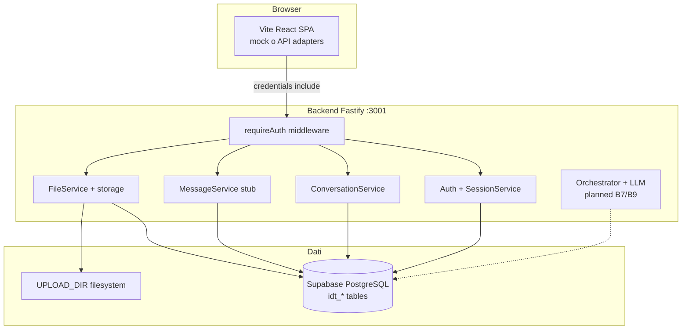

# IntentDraft

> **Tu spieghi cosa vuoi ottenere. IntentDraft trasforma la tua idea in istruzioni chiare per il tuo LLM** — chiedendo solo ciò che conta.

Progetto **full-stack** in monorepo: prodotto SaaS conversazionale per utenti **non esperti** di prompt engineering. L’utente descrive il bisogno in linguaggio naturale; l’app interpreta l’intento, propone chiarimenti mirati quando servono e produce un **prompt strutturato** da copiare in ChatGPT, Claude o altri strumenti. **Non esegue** il prompt al posto dell’utente: il valore è nel layer di comprensione, gap analysis e composizione.

Repository pensato come **portfolio tecnico**: documentazione prodotto strutturata, contratto API FE/BE, test automatici, database cloud già collegato, roadmap verso LLM e deploy pubblico.

---

## Indice

- [Problema e valore di business](#problema-e-valore-di-business)
- [Funzionalità](#funzionalità)
- [Stato di avanzamento](#stato-di-avanzamento)
- [Competenze e stack](#competenze-e-stack)
- [Architettura](#architettura)
- [Integrazione frontend ↔ backend](#integrazione-frontend--backend)
- [Database e multi-utente](#database-e-multi-utente)
- [Cloud e deploy (pianificato)](#cloud-e-deploy-pianificato)
- [Avvio locale](#avvio-locale)
- [Test e qualità](#test-e-qualità)
- [Documentazione](#documentazione)
- [Struttura repository](#struttura-repository)

---

## Problema e valore di business

| Aspetto | Descrizione |
| -------- | ------------ |
| **Problema** | Molti utenti sanno *cosa* vogliono da un LLM ma non *come* istruirlo (contesto, vincoli, formato, verifiche) → risultati generici e troppi round-trip. |
| **Target beta** | Generalisti (email, note, post, compiti vari); secondari professionisti e PMI. Personas documentate in [`docs/product/requirements/product-requirements.md`](docs/product/requirements/product-requirements.md). |
| **Differenziazione** | Non “prompt più lunghi”, ma **intento + assunzioni esplicite + decomposition** per compiti complessi. |
| **Modello di business (beta)** | Account e persistenza; **nessun pagamento** in questa fase; output = testo prompt (portabilità). Go-live cloud e monetizzazione sono roadmap esplicita, non scope attuale. |

Concept originale: [`docs/concept/initial-brainstorming.md`](docs/concept/initial-brainstorming.md).

---

## Funzionalità

### Esperienza utente (frontend)

- **Landing e pagine pubbliche** (brand glassmorphism, dark/light, IT/EN con i18next).
- **Registrazione, login, logout** con form validati (React Hook Form + Zod).
- **Area chat** (`/app`): sidebar conversazioni (nuova chat, rinomina, pin, progetto, elimina), thread messaggi, composer con allegati.
- **Motore conversazionale completo in modalità mock**: analisi intento, domande di chiarimento, pannello “cosa ho capito”, editor prompt, copia, rigenera, rifiuti su ambiti medico/legal (logica in `frontend/src/lib/mockConversationEngine.ts`).
- **Anteprima documenti** (PDF via pdf.js) e download allegati.
- **Impostazioni profilo** (UI pronta; persistenza API in corso).
- **Routing** HashRouter (compatibile con hosting statico/CDN senza rewrite server-side).

### API backend (implementato)

| Area | Endpoint (riepilogo) | Note |
| ----- | --------------------- | ----- |
| Health | `GET /api/health` | `{ ok, db }` — ping PostgreSQL |
| Auth | `POST /api/auth/register`, `login`, `logout`; `GET /api/auth/me` | Cookie httpOnly firmato, sessioni in DB |
| Conversazioni | CRUD `/api/conversations` | Scope rigoroso per `user_id`; metadata JSON (pin, progetto) |
| Messaggi | `POST /api/conversations/:id/messages` | Persistenza user + **risposta assistant stub** (motore AI server-side non ancora collegato) |
| File | upload/list/delete/download | Multipart, allowlist MIME, limite dimensione, storage filesystem `UPLOAD_DIR` |

Contratto dettagliato: [`docs/product/planning/frontend-implementation-spec.md`](docs/product/planning/frontend-implementation-spec.md) §8.

### In roadmap (documentata, non ancora in produzione)

- **B6** — Profilo utente, API prompt e feedback su `idt_prmt`.
- **B7** — Port del mock engine lato server (parità UX mock ↔ API).
- **B8** — Google OAuth (opzionale).
- **B9** — Integrazione **Anthropic Claude Sonnet** (chiavi solo server-side); design in [`docs/product/ai/ai-prompt-engine-design.md`](docs/product/ai/ai-prompt-engine-design.md).
- **B10** — Rate limiting, CI su PR, hardening.
- **INF** — Deploy staging/prod, CDN, object storage per upload, WAF — guida in [`docs/product/architecture/cloud-deployment-guide.md`](docs/product/architecture/cloud-deployment-guide.md).

Sequenza operativa e milestone: [`worklog.md`](worklog.md).

---

## Stato di avanzamento

| Milestone | Contenuto | Stato |
| --------- | --------- | ----- |
| **M0** | Health + DB Supabase | ✅ |
| **M1** | Auth cookie + sessioni | ✅ |
| **M2** | Chat persistita (messaggi stub) | ✅ |
| **M3** | Upload file + download | ✅ (backend + FE adapter; verifica E2E manuale consigliata) |
| **M4** | UX mock su API (orchestrator server) | ⏳ |
| **M5** | LLM Claude in produzione | ⏳ |
| **M6** | Deploy cloud + readiness globale | 📋 documentato, non implementato |

**Modalità demo consigliata oggi**

- **Solo UI / flusso AI completo:** `frontend` con `VITE_USE_MOCK=true` (default).
- **Stack reale auth + DB + file:** `VITE_USE_MOCK=false` + backend su `:3001` — thread e allegati su Supabase; risposte assistant ancora placeholder fino a B7/B9.

---

## Competenze e stack

Dimostrazione pratica di **progettazione prodotto + ingegneria software**: requisiti MoSCoW, ADR, schema dati, contratto API condiviso, adapter pattern, test di integrazione con DB reale.

### Frontend (`frontend/`)

| Tecnologia | Uso |
| ----------- | ----- |
| **Vite 6**, **React 18**, **TypeScript** | SPA, build e type-safety |
| **Tailwind CSS**, **Radix Slot**, **CVA** | UI system (da [react-typescript-template](https://github.com/luismalamoc/react-typescript-template)) |
| **React Router 7** (HashRouter) | Routing e area protetta |
| **Zustand** | Stato auth e conversazioni |
| **i18next** | Localizzazione IT/EN |
| **Zod** + **React Hook Form** | Validazione form |
| **pdfjs-dist** | Anteprima PDF |
| **Vitest** | Test client HTTP |
| **Playwright** | Smoke E2E e responsive |

### Backend (`backend/`)

| Tecnologia | Uso |
| ----------- | ----- |
| **Node.js 20+**, **Fastify 5** | API REST, plugin CORS/cookie/multipart |
| **TypeScript** | Moduli auth, conversations, messages, files |
| **Prisma 6** | ORM, migrazioni, tipi |
| **PostgreSQL (Supabase)** | Persistenza cloud già in uso in sviluppo |
| **bcrypt** | Hash password |
| **Zod** | Validazione env e payload |
| **Vitest** | Unit + **integration test** contro `DATABASE_URL` |

### DevOps / dati (attuale e target)

- **Oggi:** DB managed **Supabase**; API e FE in locale; upload su disco locale.
- **Target (guida scritta):** FE statico su CDN, API su container/PaaS, secret manager, object storage per file, rate limit edge, monitoring su `/api/health`.

---

## Architettura



Decisioni architetturali (monorepo, cookie session server-side, Prisma, no monolith Next): [`docs/product/decisions/adr-001-stack-and-auth.md`](docs/product/decisions/adr-001-stack-and-auth.md).

Diagramma e fasi: [`docs/product/architecture/technical-architecture.md`](docs/product/architecture/technical-architecture.md).

---

## Integrazione frontend ↔ backend

1. **Port pattern (hexagonal light):** il frontend non chiama `fetch` sparsi; usa **adapter** mock vs API (`frontend/src/adapters/`) selezionati da `VITE_USE_MOCK` via `PortsProvider`.
2. **Contratto unico:** DTO allineati tra `frontend/src/types/api.ts` e mapper backend (`conversationDto`, `userMapper`, ecc.).
3. **Auth:** cookie di sessione httpOnly; client API con `credentials: 'include'`; CORS con origine esplicita (`CORS_ORIGIN`).
4. **Bootstrap:** dopo login, **hydrate** lista conversazioni da `GET /api/conversations` (IF-04).
5. **File:** upload multipart; download blob con cookie (`fetchFileBlob`, anteprima documenti).

Operazioni mappate OP-A* / IF-*: [`docs/product/architecture/frontend-backend-operations.md`](docs/product/architecture/frontend-backend-operations.md).

---

## Database e multi-utente

Schema PostgreSQL con prefisso tabelle **`idt_*`** (naming compatto):

| Tabella | Ruolo |
| ------- | ----- |
| `idt_user` | Account (local / google futuro) |
| `idt_sess` | Sessioni server-side |
| `idt_conv` | Conversazioni + metadata JSON |
| `idt_msgs` | Messaggi user/assistant/system |
| `idt_file` | Metadati allegati |
| `idt_prmt` | Versioni prompt (per fase LLM) |

**Isolamento dati:** ogni query conversazione/file scoped by `user_id` dalla sessione; accesso cross-account → `404` (testato in integrazione).

Definizione ER e convenzioni: [`docs/product/architecture/database-design.md`](docs/product/architecture/database-design.md) · schema Prisma: [`backend/prisma/schema.prisma`](backend/prisma/schema.prisma).

---

## Cloud e deploy (pianificato)

Il database è **già cloud** (Supabase). Manca la pubblicazione di API + frontend e storage upload persistente in produzione.

| Componente | Locale oggi | Target cloud |
| ----------- | ------------- | -------------- |
| PostgreSQL | Supabase | Stesso progetto o env prod dedicato |
| API Fastify | `:3001` | HTTPS dietro reverse proxy / PaaS |
| Frontend | Vite dev / `dist/` | CDN + dominio statico |
| Upload | `./uploads` | Volume o S3-compatible + CDN download |
| Anthropic | — | Solo env server (mai esposto al browser) |

Checklist INF-001…006, costi indicativi, cookie `Secure` in prod, GDPR, utenti globali: [`docs/product/architecture/cloud-deployment-guide.md`](docs/product/architecture/cloud-deployment-guide.md).

---

## Avvio locale

### Prerequisiti

- Node.js **20+**
- Progetto **Supabase** con `DATABASE_URL` in `backend/.env`
- `SESSION_SECRET` ≥ 32 caratteri, `PORT=3001`, `CORS_ORIGIN=http://localhost:5173`

### Backend

```bash
cd backend
cp .env.example .env
# imposta DATABASE_URL e SESSION_SECRET
npm install
npm run db:push   # oppure npm run db:migrate:deploy
npm run dev       # http://localhost:3001
```

Verifica: `curl http://localhost:3001/api/health` → `{"ok":true,"db":true}`.

Dettaglio Supabase e migrazioni: [`backend/README.md`](backend/README.md).

### Frontend

```bash
cd frontend
cp .env.example .env
npm install
npm run dev       # http://localhost:5173
```

Per API reale:

```env
VITE_USE_MOCK=false
VITE_API_URL=http://localhost:3001
```

### Entrambi dalla root

```bash
npm install
npm run dev:all
```

---

## Test e qualità

| Suite | Comando | Cosa copre |
| ----- | ------- | ----------- |
| Backend unit | `cd backend && npm run test` | env, password hashing |
| Backend integration | stesso comando (con `DATABASE_URL`) | auth, conversations, messages, files |
| Frontend unit | `cd frontend && npm run test` | client API |
| Frontend E2E | `cd frontend && npx playwright install chromium && npm run test:e2e` | smoke navigazione, responsive |

Rubric qualità prompt e casi T-* (futuro LLM): [`docs/product/quality/testing-and-evaluation.md`](docs/product/quality/testing-and-evaluation.md).

Requisiti FR/NFR approvati: [`docs/product/requirements/product-requirements.md`](docs/product/requirements/product-requirements.md).

---

## Documentazione

| Documento | Contenuto |
| --------- | --------- |
| [`docs/product/README.md`](docs/product/README.md) | Indice specifica prodotto |
| [`worklog.md`](worklog.md) | Stato sprint, checklist B0–B11, test manuali |
| [`docs/product/planning/backend-implementation-plan.md`](docs/product/planning/backend-implementation-plan.md) | Piano backend dettagliato |
| [`docs/product/planning/frontend-implementation-spec.md`](docs/product/planning/frontend-implementation-spec.md) | Contratto API e accettazione FE |
| [`docs/product/planning/beta-roadmap.md`](docs/product/planning/beta-roadmap.md) | Roadmap FOUND / BETA |
| [`docs/product/experience/user-journeys-and-ux.md`](docs/product/experience/user-journeys-and-ux.md) | Journey e stati UI |

---

## Struttura repository

```
IntentDraft/
├── frontend/          # Vite + React (UI, mock engine, adapter API)
├── backend/           # Fastify + Prisma + moduli REST
├── docs/              # Concept, product spec, architecture, AI design
├── worklog.md         # Diario operativo e milestone
└── package.json       # dev:all (concurrently)
```

---

## Licenza

Frontend: MIT (vedi [`frontend/LICENSE`](frontend/LICENSE)). Resto del monorepo: uso portfolio / progetto personale salvo diversa indicazione in repo.

---

**IntentDraft** — da idea in [`docs/concept/initial-brainstorming.md`](docs/concept/initial-brainstorming.md) a beta tecnica con persistenza reale, verso motore AI server-side e deploy cloud documentato.
