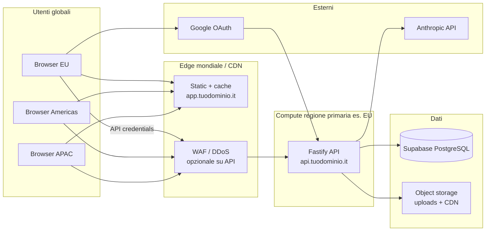

# Guida al deploy cloud — IntentDraft

**Documento:** `cloud-deployment-guide.md`  
**Versione:** 1.1  
**Data:** 2026-10-30  
**Stato attuale del codice:** monorepo `frontend/` (Vite + React, HashRouter) + `backend/` (Fastify + Prisma); database **PostgreSQL già su Supabase** (cloud). In locale: FE `:5173`, API `:3001`.

**Scopo:** descrivere tutto ciò che serve per passare da **localhost** a un **ambiente cloud** accessibile via Internet (beta privata o pubblica), con scelte di provider, dimensionamento, costi, sicurezza e checklist operativa — incluso il scenario **molti utenti da reti diverse in tutto il mondo** (multi-utente globale, non multi-tenant organizzazioni).

**Decisioni prodotto correlate:** OQ-005 / OQ-012 (hosting rinviato in fase founder) — questo documento prepara la fase successiva senza imporre una data di go-live.

---

## 1. Cosa significa “andare in cloud” per IntentDraft

Oggi l’architettura runtime è già **ibrida**:

| Componente | Dove gira oggi | Dove girerà in cloud |
| ---------- | -------------- | -------------------- |
| PostgreSQL (tabelle `idt_*`) | **Supabase** (già remoto) | Stesso progetto Supabase (o upgrade piano / nuovo progetto prod) |
| API Node (Fastify) | `localhost:3001` | VM, container o PaaS con HTTPS |
| UI statica (Vite build) | `localhost:5173` (dev) | CDN / object storage + HTTPS |
| File upload (`UPLOAD_DIR`) | Disco locale `./uploads` | Volume persistente **oppure** object storage (S3-compatible) |
| Anthropic (futuro B9) | Non attivo | Solo variabili server-side sull’host API |
| Segreti (`SESSION_SECRET`, `DATABASE_URL`) | `backend/.env` locale | Secret manager / env del provider |

**Non serve “spostare il database”** se resti su Supabase: serve soprattutto **pubblicare API + frontend** e rendere **persistenti** gli upload.



---

## 2. Prerequisiti software (prima del go-live)

Completare questi blocchi **prima** di esporre l’app su Internet riduce rischio e costi imprevisti.

| Prerequisito | Riferimento worklog | Perché blocca il deploy |
| ------------ | ------------------- | ------------------------ |
| Auth + sessioni cookie in produzione | B2 | Già presente; verificare `NODE_ENV=production` → cookie `Secure` |
| CRUD conversazioni | B3 | Base dati utente |
| Messaggi persistiti | B4 | Prodotto inutilizzabile senza thread |
| Upload file + download | B5 | Richiede storage persistente in cloud |
| Rate limiting auth/messages | B10 / NFR-003 | Obbligatorio su endpoint pubblici |
| Logging senza contenuto chat | NFR-005 | Compliance e leak |
| CI build + test | B10 | Evita deploy manuali rotti |
| `LLM_ENABLED` + chiave Anthropic | B9 | Budget e abuse se esposto senza limiti |

**Checklist “minimo deployabile” (M3):** auth reale, chat + file su Supabase, HTTPS, CORS corretto, backup upload, health check monitorato.

**Checklist “beta pubblica” (M4–M5):** sopra + rate limit + runbook segreti + metriche costo LLM (NFR-010) + privacy/GDPR base.

---

## 3. Architettura di deploy consigliata

### 3.1 Pattern consigliato (beta → crescita)

**Separazione frontend / backend** (allineata ad ADR-001 e al contratto API §8):

1. **Frontend:** build statica `frontend/dist` → hosting statico (CDN).
2. **Backend:** processo Node `npm run build && npm run start` dietro reverse proxy TLS.
3. **Database:** Supabase (regione **EU** consigliata per utenti IT/Europa).
4. **File:** volume montato sul server API **oppure** bucket S3-compatible (scale path).

**Perché non un solo server monolitico subito:** il frontend è già ottimizzato per deploy statico (`HashRouter`); CDN costa poco e scala bene; l’API può restare su macchina piccola finché il traffico è basso.

### 3.2 Domini e URL

Esempio coerente con cookie cross-subdomain (stesso **eTLD+1**):

| Servizio | URL esempio |
| -------- | ------------- |
| UI | `https://app.intentdraft.example` |
| API | `https://api.intentdraft.example` |
| Health | `https://api.intentdraft.example/api/health` |

**Evitare** FE su `*.pages.dev` e API su dominio totalmente diverso senza analisi cookie: con sessioni `SameSite=Lax` e `credentials: true`, restare su **sottodomini dello stesso dominio registrato** è la scelta più sicura.

### 3.3 Variabili d’ambiente in produzione

**Backend** (da `backend/src/config/env.ts` e `backend/.env.example`):

| Variabile | Produzione | Note |
| --------- | ---------- | ---- |
| `NODE_ENV` | `production` | Abilita `trustProxy` e cookie `Secure` |
| `PORT` | `3001` (o quella del container) | Spesso `8080` su PaaS |
| `CORS_ORIGIN` | URL esatto della UI | Es. `https://app.intentdraft.example` — **una origine**, no `*` con cookie |
| `DATABASE_URL` | Pooler Supabase `:6543` + `?pgbouncer=true` | Runtime API; migrazioni con connessione **direct** `:5432` |
| `SESSION_SECRET` | ≥ 32 byte random | Rotazione documentata in runbook |
| `SESSION_COOKIE_NAME` | default ok | |
| `SESSION_TTL_DAYS` | 14 o policy prodotto | |
| `UPLOAD_DIR` | path assoluto su volume | Es. `/data/uploads` |
| `MAX_UPLOAD_BYTES` | allineato a FE | Default 5 MiB |
| `MAX_MESSAGE_CHARS` | allineato a FE | Default 12000 |
| `LLM_ENABLED` | `false` fino a B9 pronto | |
| `ANTHROPIC_API_KEY` | (futuro) | Solo server, mai `VITE_*` |

**Frontend** (build-time, `frontend/.env.production` o CI secrets):

| Variabile | Produzione |
| --------- | ---------- |
| `VITE_USE_MOCK` | `false` |
| `VITE_API_URL` | `https://api.intentdraft.example` |
| `VITE_GOOGLE_AUTH_START_URL` | `https://api.../api/auth/google` (quando B8) |
| `VITE_MAX_MESSAGE_CHARS` | come backend |
| `VITE_MAX_UPLOAD_BYTES` | come backend |

**Supabase:** usare password DB dedicata, non anon key in `DATABASE_URL`. Limitare IP solo se l’API ha IP fisso (tipico su VPS); su PaaS con IP dinamici spesso si usa solo TLS + secret forte.

### 3.4 Database Supabase in produzione

| Operazione | Connection string |
| ---------- | ----------------- |
| `prisma migrate deploy` (CI o job one-shot) | **Direct** `5432` |
| Runtime API (`@prisma/client`) | **Transaction pooler** `6543` + `pgbouncer=true` |

Documentazione Prisma: [Supabase + Prisma](https://www.prisma.io/docs/guides/database/supabase).

**Piano Supabase:** per beta con pochi utenti può bastare **Free**; per backup automatici, più connessioni e supporto → **Pro** (~25 USD/mese). Valutare progetto **separato** dev/staging/prod quando esci dalla fase founder.

### 3.5 Build e avvio

```bash
# Backend (su server o immagine Docker)
cd backend
npm ci
npm run build
npx prisma migrate deploy   # job CI/CD, non ogni restart
npm run start               # node dist/index.js

# Frontend (in CI, artefatti su CDN)
cd frontend
npm ci
npm run build               # output in frontend/dist
```

Root monorepo: oggi solo `dev:all`; in CI conviene **due job paralleli** (FE + BE).

### 3.6 File upload in cloud

Oggi i file vanno su `UPLOAD_DIR` locale. In cloud:

| Opzione | Pro | Contro |
| ------- | --- | ------ |
| **Volume persistente** montato sulla VM/container | Zero cambi codice B5 | Backup manuale; scaling orizzontale difficile |
| **Object storage** (Supabase Storage, S3, R2) | Durabile, cheap, multi-istanza | Richiede adattamento `File service` (post-M3) |

Per **primo deploy**, un volume da 10–20 GiB sullo stesso host dell’API è accettabile; pianificare migrazione a object storage prima di più repliche API.

---

## 4. Specifiche macchina (dimensionamento)

Stime per **Node 20**, API Fastify + Prisma, traffico **beta** (ordine: decine–centinaia utenti attivi, non migliaia di RPS).

### 4.1 Profili

| Profilo | Utenti indicativi | vCPU | RAM | Disco | Banda |
| ------- | ----------------- | ---- | --- | ----- | ----- |
| **S — Lab / staging** | Solo team | 1 | 1–2 GiB | 10 GiB (+ DB Supabase) | Bassa |
| **M — Beta privata** | ≤ 50 MAU | 2 | 2–4 GiB | 20 GiB volume upload | Moderata |
| **L — Beta pubblica** | ≤ 500 MAU | 2–4 | 4–8 GiB | 40–80 GiB | Moderata–alta |
| **XL — Post-LLM** | LLM attivo | 4 | 8 GiB | 80 GiB + object storage | Alta verso Anthropic |

**Nota LLM:** il carico CPU/RAM dell’API resta modesto; il collo di bottiglia è **latency e quota Anthropic** + **connessioni DB**. Con LLM, priorità a rate limit (NFR-003) e timeout (NFR-002), non a 16 vCPU.

### 4.2 Cosa non hostare tu (managed)

- **PostgreSQL:** Supabase (già).
- **TLS edge:** Cloudflare / LB del provider.
- **Frontend statico:** CDN (CPU trascurabile).

### 4.3 Requisiti di rete

- HTTPS obbligatorio (cookie `Secure` in produzione).
- Reverse proxy con header `X-Forwarded-For` / `X-Forwarded-Proto` — Fastify ha `trustProxy: true` in production.
- Uptime target beta: best-effort (NFR-011); health check ogni 1–5 min su `/api/health` (`db: true`).

---

## 5. Quale provider cloud utilizzare

Non esiste un unico “migliore”: dipende da budget, competenza DevOps e GDPR.

### 5.1 Raccomandazione per IntentDraft (fondatore EU, stack attuale)

| Priorità | Scelta | Ruolo |
| -------- | ------ | ----- |
| **1 (consigliata beta)** | **[Hetzner Cloud](https://www.hetzner.com/cloud)** CX22/CX32 (EU) + **Docker Compose** o **[Coolify](https://coolify.io/)** | API + volume upload; costo fisso basso, datacenter DE/FI |
| **2 (meno ops)** | **[Fly.io](https://fly.io/)** o **[Railway](https://railway.app/)** | Deploy container da repo; volume Fly per upload |
| **3 (frontend)** | **[Cloudflare Pages](https://pages.cloudflare.com/)** o **[Netlify](https://www.netlify.com/)** | Hosting `frontend/dist`, CI Git |
| **DB** | **[Supabase](https://supabase.com/)** regione EU | Già in uso |
| **4 (scale enterprise)** | AWS / GCP / Azure | Quando servono IAM avanzato, compliance certificata, multi-region |

**Bundle “beta EU” tipico:** Cloudflare Pages (FE) + Hetzner 1 VM (BE) + Supabase Pro (DB) ≈ **30–45 €/mese** fissi + dominio + LLM variabile.

### 5.2 Confronto sintetico provider (API backend)

| Provider | Tipo | EU region | Adatto a IntentDraft | Ops richieste |
| -------- | ---- | --------- | -------------------- | ------------- |
| **Hetzner** | VPS | Sì (DE/FI) | Ottimo rapporto €/RAM | Media (SSH, updates, firewall) |
| **DigitalOcean** | VPS/PaaS | AMS | Simile a Hetzner, più caro | Media |
| **Fly.io** | Container | AMS/FRA | Buon DX, scale piccolo | Bassa–media |
| **Railway / Render** | PaaS | EU spesso disponibile | Deploy veloce da Git | Bassa |
| **AWS Lightsail** | VPS managed | Sì | Punta di ingresso AWS | Media |
| **AWS ECS/Fargate** | Container | Sì | Overkill per beta iniziale | Alta |
| **Google Cloud Run** | Serverless container | Sì | Pay-per-use; attenzione cold start + volumi | Media |
| **Azure Container Apps** | Container | Sì | Enterprise / Microsoft stack | Media–alta |
| **OVH / Scaleway** | VPS EU | Sì | Alternativa EU a Hetzner | Media |

**Frontend statico:** Cloudflare Pages / Netlify / Vercel (solo FE) — tutti adatti; Pages + stesso account Cloudflare del DNS è comodo.

### 5.3 Criteri di scelta (checklist decisionale)

1. **Residenza dati UE** — Supabase project region + compute EU + bucket EU.
2. **Costo fisso vs variabile** — VPS prevedibile; Cloud Run variabile con spike LLM.
3. **Persistenza file** — verificare che il piano supporti **volumi** o prevedere S3 subito.
4. **CI/CD** — GitHub Actions + deploy SSH o API Fly/Railway.
5. **Egress** — upload/download file: preferire CDN o object storage vicino agli utenti.
6. **Competenza team** — se zero DevOps, Fly/Railway/Coolify battono EC2 raw.

---

## 6. Stima costi (ordine di grandezza, 2026)

Prezzi cambiano; usare calcolatrici ufficiali prima dell’ordine. Valori in **EUR** indicativi (1 USD ≈ 0,92 EUR).

### 6.1 Infrastruttura fissa (senza LLM)

| Voce | Tier beta | €/mese circa |
| ---- | --------- | -------------- |
| Dominio `.it` / `.com` | 1 dominio | 1–15 (annuale/12) |
| DNS + CDN + WAF base | Cloudflare Free | 0 |
| Frontend statico | Cloudflare Pages Free | 0 |
| VM API | Hetzner CX22 (2 vCPU, 4 GiB) | 4–6 |
| Backup snapshot VM | Opzionale | 1–3 |
| Supabase | Free → Pro | 0 → ~23 |
| Email transazionale (auth, alert) | Resend/Sendgrid free tier | 0 |
| **Totale infra beta** | | **~5–35** |

### 6.2 Variabili e servizi futuri

| Voce | Driver costo | Ordine grandezza |
| ---- | -------------- | ---------------- |
| **Anthropic Claude Sonnet** | Token in/out per conversazione | Da ~0,01–0,10 € per sessione “ricca” (dipende da lunghezza); monitor NFR-010 |
| **Egress** | Download file / API | Spesso incluso fino a TB su VPS; verificare |
| **Object storage** | GB-mese + richieste | ~0,02 €/GiB (R2/S3 class) |
| **Google OAuth** | Gratuito | 0 |
| **Monitoring** | Sentry / Better Stack free tier | 0 → 20+ |
| **Certificati TLS** | Let’s Encrypt | 0 |

### 6.3 Scenari mensili totali (indicativi)

| Scenario | Descrizione | €/mese infra | LLM (100 utenti × 10 chat) |
| -------- | ----------- | -------------- | ---------------------------- |
| **A — Staging** | 1 VM piccola + Supabase free | ~5–10 | 0 |
| **B — Beta chiusa** | VM M + Supabase Pro | ~30–40 | 0–50 |
| **C — Beta + LLM** | Come B | ~30–40 | 50–500+ (uso reale) |

**Leva principale sul costo:** disabilitare LLM in staging (`LLM_ENABLED=false`), limiti rate, cache non applicabile al testo generato — focus su **quota per utente** lato prodotto.

---

## 7. Sicurezza e conformità

### 7.1 Checklist sicurezza tecnica

- [ ] HTTPS ovunque; HSTS dopo verifica stabilità.
- [ ] `SESSION_SECRET` e `DATABASE_URL` solo in secret store; rotazione annuale o su incidente.
- [ ] Firewall: esporre solo 443 (e 80 → redirect); SSH solo da IP fidati o bastion.
- [ ] Aggiornamenti OS/container programmati.
- [ ] Rate limit su `/api/auth/*` e `/api/conversations/*/messages` (NFR-003).
- [ ] Nessun contenuto messaggi nei log (NFR-005).
- [ ] Upload: MIME allowlist, max size, path UUID (già in piano B5).
- [ ] Dependency audit in CI (`npm audit`, Dependabot).

### 7.2 GDPR (utenti EU)

IntentDraft tratta **account, conversazioni, file, prompt** — dati personali se l’utente inserisce testo identificativo.

| Tema | Azione |
| ---- | ------ |
| Base giuridica | Definire (contratto / legittimo interesse) con consulenza se beta pubblica |
| Informativa privacy | Pagina dedicata + cookie policy |
| DPA | Supabase, Anthropic, provider hosting — accettare DPA / SCC |
| Residenza | Progetto Supabase EU + compute EU |
| Diritti utente | Export/cancel account (endpoint futuri o procedura manuale beta) |
| Retention | Policy su sessioni scadute, file orphan, backup |
| Registro trattamenti | Documentazione interna |

Riferimento decisionale: OQ-012 — da chiudere prima della beta pubblica ampia.

### 7.3 OAuth Google (B8)

Registrare in Google Cloud Console:

- Origini JavaScript autorizzate: URL UI.
- Redirect URI: `https://api.../api/auth/google/callback` (path esatto da implementazione B8).

---

## 8. CI/CD e ambienti

### 8.1 Ambienti consigliati

| Ambiente | Scopo | DB | LLM |
| -------- | ----- | -- | --- |
| **local** | Sviluppo | Supabase dev o locale | off |
| **staging** | QA pre-release | Supabase progetto separato | off o chiave test |
| **production** | Utenti reali | Supabase prod | flag controllato |

### 8.2 Pipeline GitHub Actions (schema)

1. **PR:** `lint` + `test` backend; `lint` + `test` + `build` frontend.
2. **Merge su `main`:**
   - Job `migrate`: `prisma migrate deploy` su staging/prod con secret `DATABASE_URL_DIRECT`.
   - Job `deploy-api`: build Docker o rsync + restart.
   - Job `deploy-fe`: `npm run build` → upload su Pages/Netlify.

3. **Smoke post-deploy:** `curl -f https://api.../api/health`.

### 8.3 Docker (opzionale, consigliato)

Oggi il repo **non** include Dockerfile; aggiungerli prima del deploy automatizzato.

Esempio minimo backend (da validare in repo):

```dockerfile
FROM node:20-alpine AS build
WORKDIR /app
COPY package*.json prisma ./
RUN npm ci
COPY . .
RUN npm run build

FROM node:20-alpine
WORKDIR /app
ENV NODE_ENV=production
COPY --from=build /app/dist ./dist
COPY --from=build /app/node_modules ./node_modules
COPY --from=build /app/prisma ./prisma
COPY package.json .
EXPOSE 3001
CMD ["node", "dist/index.js"]
```

Montare volume su `/data/uploads` e impostare `UPLOAD_DIR=/data/uploads`.

---

## 9. Multi-utente globale e reti diverse

Questa sezione copre **molti account utente** che accedono da **reti, Paesi e operatori diversi** (mobile, corporate NAT, VPN, IPv4/IPv6).  
**Non** copre il **multi-tenant B2B** (organizzazioni, workspace condivisi, billing per team) — escluso dalla beta (OQ-007); il modello attuale resta **un utente = un `user_id`**, isolamento già garantito a livello API (scope sessione, vedi test B3-M06 nel worklog).

### 9.1 Cosa resta uguale in cloud

| Aspetto | Comportamento |
| ------- | ------------- |
| Isolamento dati | Ogni conversazione/file legato a `user_id`; stesse regole 404 cross-account |
| Auth | Cookie httpOnly firmato sull’origine API; `credentials: true` dal browser |
| i18n | IT + EN (NFR-009) — utile per base utenti non solo UE |
| LLM | Chiamate server-side verso Anthropic; latenza extra per utenti lontani dalla regione API |

### 9.2 Implicazioni delle reti globali

| Tema | Problema | Mitigazione (fase consigliata) |
| ---- | -------- | ------------------------------ |
| **Latenza UI** | Utenti lontani dalla regione API | **CDN edge** per asset statici (subito); API in **una regione primaria** (es. EU) accettabile per beta |
| **Latenza API / LLM** | RTT alto da APAC/Americas verso EU | Feedback UI entro 500 ms dove possibile (NFR-006); operazioni LLM async; in futuro valutare regione API più vicina alla maggioranza utenti |
| **NAT / IP condivisi** | Rate limit solo per IP penalizza uffici | Rate limit **per sessione/utente** oltre che per IP (B10); captcha su auth solo se abuso |
| **Reti instabili** | Timeout upload messaggi | Retry client idempotente dove possibile; timeout configurabili (NFR-002) |
| **IPv6** | Alcuni carrier solo IPv6 | Hosting e DNS **AAAA**; verificare Supabase/pooler da entrambi gli stack |
| **Compliance** | Utenti extra-UE su DB EU | Informativa privacy + base giuridica; DPA provider; OQ-012 |
| **Abuso distribuito** | Bot da molte reti | WAF (Cloudflare), rate limit, geo block solo come extrema ratio (attenzione falsi positivi) |

### 9.3 Evoluzione architetturale (roadmap infra)

Adottare **incrementalmente** — non serve multi-regione al primo deploy.

| Fase | Target | Componenti |
| ---- | ------ | ---------- |
| **G0 — Beta EU-centric** | Primi utenti globali, API unica in EU | Cloudflare Pages (FE mondiale), API + Supabase EU, volume o bucket upload |
| **G1 — Edge sul percorso API** | Ridurre attacchi e migliorare RTT percepito | Proxy CDN/WAF davanti a `api.*`; TLS edge; cache **solo** su asset statici, mai su `/api/*` autenticato |
| **G2 — File globali** | Download/upload veloci ovunque | Object storage (S3/R2/Supabase Storage) + **CDN signed URL** per download; upload diretto browser→storage (presigned) se il volume cresce |
| **G3 — Multi-regione (solo se dati lo impongono)** | p95 latenza API o requisito residenza dati | Read replica DB; **oppure** seconda stack API+DB per continent — costo e complessità alti (sessioni, migrazioni, backup); decidere con metriche reali |

**Sessioni e multi-regione API:** con cookie di sessione e stato su PostgreSQL centrale, più istanze API **nella stessa regione** dietro load balancer sono semplici; più **regioni** richiedono DB multi-master o routing utente “sticky per regione” — fuori scope finché G0–G2 non saturano.

### 9.4 Checklist readiness “utenti da tutto il mondo”

- [ ] Frontend servito da CDN con PoP globali (non solo origin singolo).
- [ ] API esposta solo via HTTPS; `trustProxy` e limiti body upload configurati.
- [ ] Rate limit IP **+** utente/sessione su auth e messaggi.
- [ ] Monitoring latenza per regione (header `CF-IPCountry` o equivalente **solo** per metriche aggregate, non discriminazione prodotto senza policy).
- [ ] Test manuali da rete mobile (4G) e da VPN commerciali: login, invio messaggio, upload file.
- [ ] Privacy policy che copre utenti non-UE che usano infrastruttura EU.
- [ ] Piano backup/restore testato indipendentemente dalla regione dell’operatore.

### 9.5 Costi aggiuntivi tipici (globale)

| Voce | Note €/mese indicativi |
| ---- | ------------------------ |
| Cloudflare Pro (WAF avanzato) | 0–25 (Free spesso basta in beta) |
| Egress download file globale | Cresce con utenti; mitigare con CDN/cache su object storage |
| Anthropic | Stesso costo per token; latenza non cambia il prezzo ma l’UX |
| Supabase | Connessioni concurrent ↑ con utenti simultanei → Pro |

---

## 10. DNS, TLS e reverse proxy

### 10.1 Record DNS tipici

| Nome | Tipo | Target |
| ---- | ---- | ------ |
| `app` | CNAME | provider Pages (es. `xxx.pages.dev`) |
| `api` | A / AAAA | IP VM o CNAME Fly/Railway |

### 10.2 Nginx (su VPS) — sketch

```nginx
server {
  listen 443 ssl http2;
  server_name api.intentdraft.example;
  # ssl_certificate ... (certbot)

  location / {
    proxy_pass http://127.0.0.1:3001;
    proxy_http_version 1.1;
    proxy_set_header Host $host;
    proxy_set_header X-Real-IP $remote_addr;
    proxy_set_header X-Forwarded-For $proxy_add_x_forwarded_for;
    proxy_set_header X-Forwarded-Proto $scheme;
  }
}
```

Certbot per Let’s Encrypt; rinnovo automatico.

---

## 11. Osservabilità e operazioni

| Area | Strumento suggerito | Cosa monitorare |
| ---- | ------------------- | --------------- |
| Uptime | UptimeRobot / Better Stack | `/api/health`, `db: true` |
| Errori API | Sentry (Node SDK) | 5xx, eccezioni non gestite |
| Log | journald / provider log | **no** body messaggi |
| Metriche LLM | log strutturato custom | token, costo per request (B9) |
| Backup DB | Supabase Pro backups | PITR |
| Backup file | snapshot volume o sync bucket | giornaliero |

**Runbook minimi da scrivere in `docs/` (post go-live):**

- Rotazione `SESSION_SECRET` (invalida sessioni).
- Ripristino DB da backup Supabase.
- Rollback deploy API (tag immagine precedente).
- Incidente leak chiave Anthropic.

---

## 12. Piano di esecuzione passo-passo

### Fase 0 — Preparazione (in repo, senza cloud)

1. Completare M3 (file upload) e B10 (rate limit, CI).
2. Aggiungere `Dockerfile` backend + `.dockerignore`.
3. Creare `frontend/.env.production.example`.
4. Documentare runbook segreti.

### Fase 1 — Staging cloud

1. Acquistare dominio; configurare DNS su Cloudflare.
2. Progetto Supabase **staging**; applicare migrazioni.
3. Deploy API su VM/PaaS staging; volume upload.
4. Deploy FE su Pages con `VITE_API_URL` staging.
5. Test manuali B2–B5 + smoke Playwright API mode.
6. Verificare cookie: login → F5 → sessione ok su dominio staging.

### Fase 2 — Produzione beta

1. Supabase prod; seed solo se necessario (no password in repo).
2. Secret production in CI; branch protezione `main`.
3. Abilitare monitoring e alert su health fail.
4. Privacy policy + termini (se utenti esterni).
5. Go-live limitato (inviti).

### Fase 3 — LLM e scale

1. `LLM_ENABLED=true` solo prod; budget alert Anthropic.
2. Valutare object storage per file.
3. Seconda istanza API + load balancer solo se metriche lo richiedono.

---

## 13. Rischi comuni e mitigazioni

| Rischio | Sintomo | Mitigazione |
| ------- | ------- | ----------- |
| CORS errato | Login ok in curl, fail in browser | `CORS_ORIGIN` = origine esatta UI; `credentials: true` |
| Cookie non inviato | 401 dopo login | Stesso sito registrabile; HTTPS; `Secure` cookie |
| Prisma + pooler | Errori prepared statement | `pgbouncer=true`, transaction mode |
| Upload persi | Restart container | Volume persistente |
| Costi LLM | Fattura Anthropic alta | Rate limit, cap utente, staging off |
| DB connection limit | 503 sotto carico | Pooler Supabase; limitare istanze API |
| Latenza utenti remoti | UX lenta, timeout | CDN FE; proxy edge; fasi G1–G2 §9.3 |
| NAT condiviso + rate limit | 429 su uffici | Limiti per sessione/utente, non solo IP §9.2 |

---

## 14. Riferimenti interni

| Documento | Contenuto |
| --------- | --------- |
| [`../../../backend/README.md`](../../../backend/README.md) | Supabase, script, migrazioni |
| [`../../../worklog.md`](../../../worklog.md) | Milestone M0–M6, Blocco 11 INF |
| [`technical-architecture.md`](technical-architecture.md) | Componenti e fasi |
| [`database-design.md`](database-design.md) | Schema `idt_*` |
| [`../planning/backend-implementation-plan.md`](../planning/backend-implementation-plan.md) | B5 upload, B9 LLM, B10 hardening |
| [`../requirements/product-requirements.md`](../requirements/product-requirements.md) | NFR sicurezza, hosting “Won’t” fase corrente |
| [`../decisions/open-questions-and-decisions.md`](../decisions/open-questions-and-decisions.md) | OQ-005, OQ-012 |

---

## 15. Decisione riassuntiva (TL;DR)

| Domanda | Risposta suggerita |
| ------- | ------------------ |
| **Specifiche macchina beta** | 2 vCPU, 4 GiB RAM, 20 GiB volume (+ Supabase managed) |
| **Provider** | **Hetzner** (API) + **Cloudflare Pages** (FE) + **Supabase EU** (DB) |
| **Costo fisso beta** | ~**30–40 €/mese** con Supabase Pro; ~**5–10 €** se resti su free tier e traffico minimo |
| **Costo variabile** | **Anthropic** domina con LLM attivo — pianificare limiti prima del go-live |
| **Prima azione tecnica** | Completare **M3 + B10**, poi staging con HTTPS e test cookie cross-subdomain |
| **Utenti globali** | CDN per FE (G0); WAF + rate limit IP/sessione (G1); object storage + CDN file (G2) — §9 |

Aggiornare questo documento quando: (1) si introduce object storage, (2) si chiude OQ-012 con policy GDPR, (3) si aggiungono Dockerfile/Helm ufficiali in repo, (4) si attiva multi-regione (G3).
