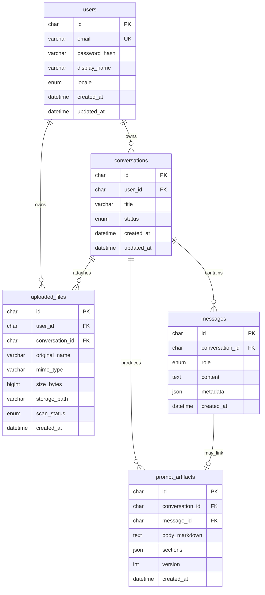

# Progettazione database — IntentDraft

**Documento:** `database-design.md`  
**Versione:** 1.0  
**DBMS:** **MySQL** (decisione founder, OQ-010)  
**Ambiente:** **localhost** (OQ-012 rinviato)  
**Stack correlato:** Prisma + MySQL (OQ-015); API Node (ADR-001)

---

## 1. Scopo

Definire lo **schema relazionale** minimo per:

- autenticazione utenti;
- persistenza conversazioni e messaggi (OQ-003 **C**);
- metadati file caricati (OQ-009 **Must** in beta);
- snapshot dei prompt generati (output testuale principale del prodotto).

Il motore **Anthropic Claude Sonnet** (OQ-002) è **accettato** ma l’integrazione API è **fase successiva**; lo schema deve già prevedere campi per messaggi assistant e `prompt_text` senza dipendere dal provider.

---

## 2. Principi

| Principio             | Descrizione                                                                                                         |
| --------------------- | ------------------------------------------------------------------------------------------------------------------- |
| Multi-tenant logico   | Ogni riga appartiene a un `user_id`                                                                                 |
| Soft delete opzionale | `deleted_at` su conversazioni/file — **Could** fase 2                                                               |
| UUID / BINARY         | ID pubblici: `CHAR(36)` UUID v4 o `BINARY(16)` — raccomandazione **UUID string** per debug locale                   |
| UTF-8                 | `utf8mb4` per IT+EN (NFR-009 aggiornato)                                                                            |
| File binari           | **Non** in MySQL; path su filesystem locale (`uploads/`) o blob solo se necessario — raccomandazione **filesystem** |

---

## 3. Diagramma ER (logico)

---

## 4. Tabelle — dettaglio

### 4.1 `users`

| Colonna         | Tipo                             | Note                   |
| --------------- | -------------------------------- | ---------------------- |
| `id`            | `CHAR(36)` PK                    | UUID                   |
| `email`         | `VARCHAR(255)` UNIQUE NOT NULL   | Normalizzare lowercase |
| `password_hash` | `VARCHAR(255)` NOT NULL          | bcrypt/argon2          |
| `display_name`  | `VARCHAR(120)` NULL              |                        |
| `locale`        | `ENUM('it','en')` DEFAULT `'it'` | Preferenza UI          |
| `created_at`    | `DATETIME(3)`                    |                        |
| `updated_at`    | `DATETIME(3)`                    |                        |

**Indici:** `UNIQUE(email)`

### 4.2 `sessions` (auth server-side)

| Colonna      | Tipo                  | Note                         |
| ------------ | --------------------- | ---------------------------- |
| `id`         | `CHAR(36)` PK         | Token sessione o ID sessione |
| `user_id`    | `CHAR(36)` FK → users |                              |
| `expires_at` | `DATETIME(3)`         |                              |
| `created_at` | `DATETIME(3)`         |                              |

**Indici:** `INDEX(user_id)`, `INDEX(expires_at)`

Alternativa: sessioni stateless JWT senza tabella — **Decisione aperta OQ-014** (vedi sotto).

### 4.3 `conversations`

| Colonna      | Tipo                                           | Note                                            |
| ------------ | ---------------------------------------------- | ----------------------------------------------- |
| `id`         | `CHAR(36)` PK                                  |                                                 |
| `user_id`    | `CHAR(36)` FK                                  |                                                 |
| `title`      | `VARCHAR(200)`                                 | Auto da prima riga user o “Nuova conversazione” |
| `status`     | `ENUM('active','archived')` DEFAULT `'active'` |                                                 |
| `created_at` | `DATETIME(3)`                                  |                                                 |
| `updated_at` | `DATETIME(3)`                                  |                                                 |

**Indici:** `INDEX(user_id, updated_at DESC)`

### 4.4 `messages`

| Colonna           | Tipo                                | Note                                      |
| ----------------- | ----------------------------------- | ----------------------------------------- |
| `id`              | `CHAR(36)` PK                       |                                           |
| `conversation_id` | `CHAR(36)` FK                       |                                           |
| `role`            | `ENUM('user','assistant','system')` |                                           |
| `content`         | `TEXT` NOT NULL                     |                                           |
| `metadata`        | `JSON` NULL                         | interpretation, assumptions, question ids |
| `created_at`      | `DATETIME(3)`                       |                                           |

**Indici:** `INDEX(conversation_id, created_at)`

### 4.5 `uploaded_files`

| Colonna           | Tipo                                                  | Note                                 |
| ----------------- | ----------------------------------------------------- | ------------------------------------ |
| `id`              | `CHAR(36)` PK                                         |                                      |
| `user_id`         | `CHAR(36)` FK                                         |                                      |
| `conversation_id` | `CHAR(36)` FK NULL                                    | Opzionale se upload pre-conversation |
| `original_name`   | `VARCHAR(255)`                                        |                                      |
| `mime_type`       | `VARCHAR(127)`                                        |                                      |
| `size_bytes`      | `BIGINT UNSIGNED`                                     | Limite config                        |
| `storage_path`    | `VARCHAR(512)`                                        | Relativo a root upload               |
| `scan_status`     | `ENUM('pending','ok','rejected')` DEFAULT `'pending'` | Estensione antivirus futura          |
| `created_at`      | `DATETIME(3)`                                         |                                      |

**Indici:** `INDEX(conversation_id)`, `INDEX(user_id)`

### 4.6 `prompt_artifacts`

| Colonna           | Tipo                     | Note                                 |
| ----------------- | ------------------------ | ------------------------------------ |
| `id`              | `CHAR(36)` PK            |                                      |
| `conversation_id` | `CHAR(36)` FK            |                                      |
| `message_id`      | `CHAR(36)` FK NULL       | Messaggio assistant associato        |
| `body_markdown`   | `MEDIUMTEXT`             | **Output principale** — testo prompt |
| `sections`        | `JSON` NULL              | Sezioni strutturate                  |
| `version`         | `INT UNSIGNED` DEFAULT 1 | Incrementa a ogni rigenerazione      |
| `created_at`      | `DATETIME(3)`            |                                      |

**Indici:** `INDEX(conversation_id, created_at DESC)`

---

## 5. Migrazioni e ORM

**Raccomandazione:** **Prisma** o **Drizzle** con MySQL — scelta in ADR-001 implementazione.

Ordine migrazioni suggerito:

1. `users`, `sessions`  
2. `conversations`, `messages`  
3. `uploaded_files`  
4. `prompt_artifacts`

---

## 6. Sessioni auth (OQ-014 — Accepted)

**Decisione:** tabella MySQL **`sessions`** + cookie **httpOnly** (ADR-001). Revoca logout, più sessioni per utente, evoluzione verso store Redis se necessario.

---

## 7. Tracciabilità

| Requisito                  | Tabella / campo                  |
| -------------------------- | -------------------------------- |
| FR-021 Auth                | `users`, `sessions`              |
| FR-022 Persistenza         | `conversations`, `messages`      |
| FR-023 Upload              | `uploaded_files`                 |
| FR-006–010 Prompt testuale | `prompt_artifacts.body_markdown` |

Roadmap: **FOUND-020** … **FOUND-030** in [`../planning/beta-roadmap.md`](../planning/beta-roadmap.md).
