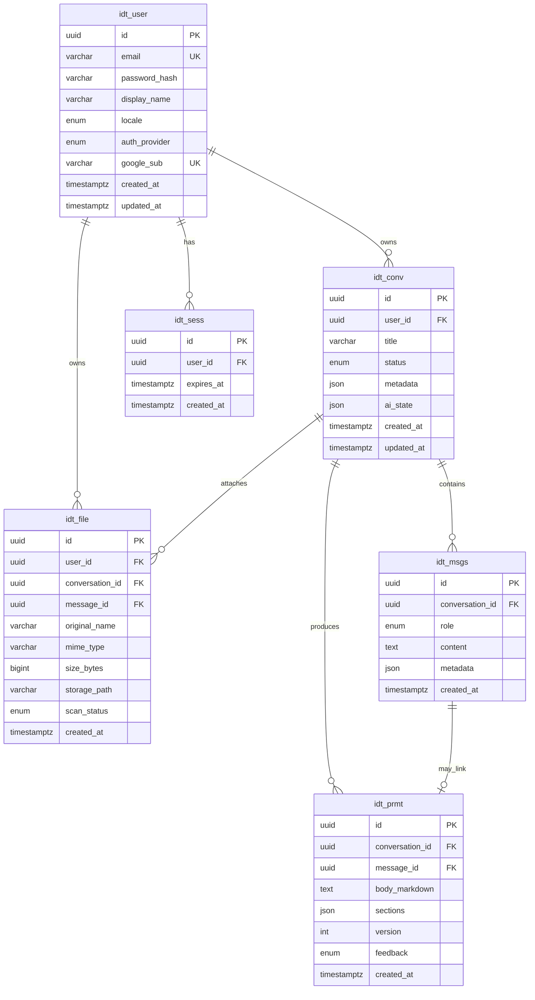

# Progettazione database — IntentDraft

**Documento:** `database-design.md`  
**Versione:** 1.1  
**DBMS:** **PostgreSQL** (Supabase) — implementazione Prisma in `backend/prisma/schema.prisma`  
**Stack correlato:** Prisma + Node API (ADR-001)

---

## 1. Scopo

Definire lo **schema relazionale** minimo per:

- autenticazione utenti;
- persistenza conversazioni e messaggi (OQ-003 **C**);
- metadati file caricati (OQ-009 **Must** in beta);
- snapshot dei prompt generati (output testuale principale del prodotto).

Il motore **Anthropic Claude Sonnet** (OQ-002) è **accettato** ma l’integrazione API è **fase successiva**; lo schema deve già prevedere campi per messaggi assistant e prompt senza dipendere dal provider.

---

## 2. Principi

| Principio             | Descrizione                                                                 |
| --------------------- | --------------------------------------------------------------------------- |
| Multi-tenant logico   | Ogni riga appartiene a un `user_id`                                         |
| Soft delete opzionale | `deleted_at` su conversazioni/file — **Could** fase 2                       |
| UUID                  | ID pubblici: UUID v4 (`uuid` in Postgres)                                   |
| UTF-8                 | IT+EN (NFR-009)                                                             |
| File binari           | **Non** in DB; path su filesystem (`uploads/`)                              |

### 2.1 Standard nomi tabella (8 caratteri)

Tutte le **tabelle fisiche** in PostgreSQL hanno nome **esattamente 8 caratteri**: prefisso prodotto `idt_` + abbreviazione 4 caratteri.

| Entità logica      | Tabella fisica | Modello Prisma   |
| ------------------ | -------------- | ---------------- |
| Utenti             | **`idt_user`** | `User`           |
| Sessioni auth      | **`idt_sess`** | `Session`        |
| Conversazioni      | **`idt_conv`** | `Conversation`   |
| Messaggi chat      | **`idt_msgs`** | `Message`        |
| File caricati      | **`idt_file`** | `UploadedFile`   |
| Artifact prompt    | **`idt_prmt`** | `PromptArtifact` |

Nei documenti operativi e nelle API REST si usano ancora i concetti *user*, *conversation*, *message*; negli INSERT/SELECT e in Supabase Table Editor compaiono i nomi **`idt_*`**.

Colonne: **snake_case** (`user_id`, `created_at`, …).

---

## 3. Diagramma ER (logico → fisico)

---

## 4. Tabelle — dettaglio

### 4.1 `idt_user` (utenti)

| Colonna           | Tipo                             | Note                          |
| ----------------- | -------------------------------- | ----------------------------- |
| `id`              | UUID PK                          |                               |
| `email`           | VARCHAR(255) UNIQUE NOT NULL     | Normalizzare lowercase        |
| `password_hash`   | VARCHAR(255) NULL                | NULL se solo OAuth Google     |
| `display_name`    | VARCHAR(120) NULL                |                               |
| `locale`          | ENUM `it`,`en` DEFAULT `it`      | Preferenza UI                 |
| `auth_provider`   | ENUM `local`,`google`            |                               |
| `role`            | ENUM `user`,`admin` DEFAULT `user` | RBAC; admin da seed dev     |
| `google_sub`      | VARCHAR(255) UNIQUE NULL         | Subject Google                |
| `created_at`      | TIMESTAMPTZ                      |                               |
| `updated_at`      | TIMESTAMPTZ                      |                               |

**Indici:** UNIQUE(`email`)

### 4.2 `idt_sess` (sessioni server-side)

| Colonna       | Tipo                  | Note                         |
| ------------- | --------------------- | ---------------------------- |
| `id`          | UUID PK               | ID sessione / token          |
| `user_id`     | UUID FK → `idt_user`  |                              |
| `expires_at`  | TIMESTAMPTZ           |                              |
| `created_at`  | TIMESTAMPTZ           |                              |

**Indici:** INDEX(`user_id`), INDEX(`expires_at`)

### 4.3 `idt_conv` (conversazioni)

| Colonna       | Tipo                              | Note                                            |
| ------------- | --------------------------------- | ----------------------------------------------- |
| `id`          | UUID PK                           |                                                 |
| `user_id`     | UUID FK                           |                                                 |
| `title`       | VARCHAR(200)                      | Auto da primo messaggio o vuoto                 |
| `status`      | ENUM `active`,`archived`          | DEFAULT `active`                                |
| `metadata`    | JSON NULL                         | `pinned`, `inProject` (FE §8)                   |
| `ai_state`    | JSON NULL                         | Fase orchestrator (opzionale)                   |
| `created_at`  | TIMESTAMPTZ                       |                                                 |
| `updated_at`  | TIMESTAMPTZ                       |                                                 |

**Indici:** INDEX(`user_id`, `updated_at` DESC)

### 4.4 `idt_msgs` (messaggi)

| Colonna            | Tipo                                | Note                                      |
| ------------------ | ----------------------------------- | ----------------------------------------- |
| `id`               | UUID PK                             |                                           |
| `conversation_id`  | UUID FK → `idt_conv`                |                                           |
| `role`             | ENUM `user`,`assistant`,`system`    |                                           |
| `content`          | TEXT NOT NULL                       |                                           |
| `metadata`         | JSON NULL                           | interpretation, assumptions, question ids |
| `created_at`       | TIMESTAMPTZ                         |                                           |

**Indici:** INDEX(`conversation_id`, `created_at`)

### 4.5 `idt_file` (file caricati)

| Colonna            | Tipo                              | Note                                 |
| ------------------ | --------------------------------- | ------------------------------------ |
| `id`               | UUID PK                           |                                      |
| `user_id`          | UUID FK                           |                                      |
| `conversation_id`  | UUID FK NULL                      |                                      |
| `message_id`       | UUID FK NULL                      | Allegato legato a messaggio          |
| `original_name`    | VARCHAR(255)                      |                                      |
| `mime_type`        | VARCHAR(127)                      |                                      |
| `size_bytes`       | BIGINT                            | Limite config                        |
| `storage_path`     | VARCHAR(512)                      | Relativo a root upload               |
| `scan_status`      | ENUM `pending`,`ok`,`rejected`    | DEFAULT `pending`                    |
| `created_at`       | TIMESTAMPTZ                       |                                      |

**Indici:** INDEX(`conversation_id`), INDEX(`user_id`)

### 4.6 `idt_prmt` (prompt generati)

| Colonna            | Tipo                     | Note                                 |
| ------------------ | ------------------------ | ------------------------------------ |
| `id`               | UUID PK                  |                                      |
| `conversation_id`  | UUID FK                  |                                      |
| `message_id`       | UUID FK NULL             | Messaggio assistant associato        |
| `body_markdown`    | TEXT                     | **Output principale** — testo prompt |
| `sections`         | JSON NULL                | Sezioni strutturate                  |
| `version`          | INT DEFAULT 1            | Incrementa a ogni rigenerazione      |
| `feedback`         | ENUM NULL                | `useful` / `not_useful` (FR-017)     |
| `created_at`       | TIMESTAMPTZ              |                                      |

**Indici:** INDEX(`conversation_id`, `created_at` DESC)

---

## 5. Migrazioni e ORM

**Implementazione:** Prisma su PostgreSQL (Supabase).

Ordine migrazioni suggerito:

1. `idt_user`, `idt_sess`  
2. `idt_conv`, `idt_msgs`  
3. `idt_file`  
4. `idt_prmt`

Comandi: `npm run db:push` (dev) o `npm run db:migrate` (versionate) in `backend/`.

---

## 6. Sessioni auth (OQ-014 — Accepted)

**Decisione:** tabella **`idt_sess`** + cookie **httpOnly** (ADR-001). Revoca logout, più sessioni per utente.

---

## 7. Tracciabilità

| Requisito                  | Tabella / campo                    |
| -------------------------- | ---------------------------------- |
| FR-021 Auth                | `idt_user`, `idt_sess`             |
| FR-022 Persistenza         | `idt_conv`, `idt_msgs`             |
| FR-023 Upload              | `idt_file`                         |
| FR-006–010 Prompt testuale | `idt_prmt.body_markdown`           |

Roadmap: **FOUND-012** … in [`../planning/beta-roadmap.md`](../planning/beta-roadmap.md).
