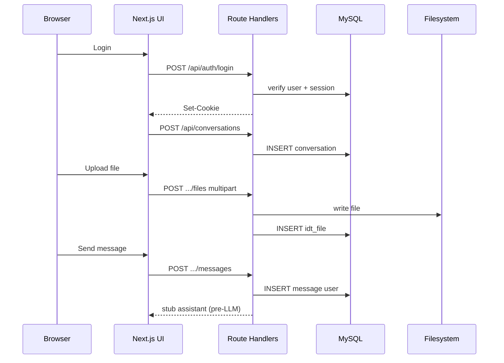

# Operazioni frontend ↔ backend — IntentDraft

**Documento:** `frontend-backend-operations.md`  
**Versione:** 1.0  
**Stack:** Vite React (template) ↔ **Node API** + **Prisma** + MySQL (CORS + credentials)  
**Fase corrente:** **fondamenta locali** — auth, DB, upload, CRUD conversazioni; **LLM Claude Sonnet in fase successiva**

---

## 1. Confini

| Layer                        | Responsabilità                                                                      |
| ---------------------------- | ----------------------------------------------------------------------------------- |
| **Frontend**                 | Pagine, form, i18n IT/EN, chiamate API autenticate, UI chat (stub fino a motore AI) |
| **Backend (Route Handlers)** | Validazione, auth, accesso MySQL, storage file locale, (futuro) proxy Anthropic     |
| **MySQL**                    | Persistenza utenti, sessioni, conversazioni, messaggi, metadati file, prompt        |

**Output prodotto:** testo prompt (`idt_prmt.body_markdown`) — nessuna esecuzione LLM nel prodotto (OQ-008 **Accepted**).  
**Tabelle DB:** nomi fisici a 8 caratteri — vedi [`database-design.md`](database-design.md) §2.1.

---

## 2. Autenticazione

Meccanismo target: **cookie di sessione httpOnly** dopo login; middleware Next.js verifica sessione su route protette.

| #      | Operazione                   | FE                        | BE                                                  | DB                                | Priorità fase iniziale |
| ------ | ---------------------------- | ------------------------- | --------------------------------------------------- | --------------------------------- | ---------------------- |
| OP-A01 | Registrazione email/password | Form + validazione client | `POST /api/auth/register` hash password, crea user  | INSERT `idt_user`                    | **P0**                 |
| OP-A02 | Login                        | Form                      | `POST /api/auth/login` verifica hash, crea sessione | SELECT `idt_user`, INSERT `idt_sess` | **P0**                 |
| OP-A03 | Logout                       | Pulsante                  | `POST /api/auth/logout` invalida sessione           | DELETE `idt_sess`                 | **P0**                 |
| OP-A04 | Sessione corrente            | Bootstrap app / layout    | `GET /api/auth/me`                                  | SELECT user by session            | **P0**                 |
| OP-A05 | Cambio lingua UI             | Selector IT/EN            | `PATCH /api/users/me` `{ locale }`                  | UPDATE `idt_user.locale`             | **P1**                 |

**Collaborazione FE↔BE:** ogni OP-A01–A04 richiede entrambi; FE non accede a MySQL; BE restituisce errori strutturati `{ code, message }` traducibili lato FE.

---

## 3. Conversazioni e messaggi (senza LLM — stub)

Finché Claude non è integrato, `POST .../messages` può persistere il messaggio user e rispondere con placeholder assistant (“Motore AI non ancora collegato”) **oppure** eco di test — utile per testare persistenza.

| #      | Operazione             | FE               | BE                                     | DB                  | Priorità |
| ------ | ---------------------- | ---------------- | -------------------------------------- | ------------------- | -------- |
| OP-C01 | Lista conversazioni    | Sidebar / home   | `GET /api/conversations`               | SELECT by `user_id` | **P0**   |
| OP-C02 | Nuova conversazione    | Pulsante “Nuova” | `POST /api/conversations`              | INSERT              | **P0**   |
| OP-C03 | Dettaglio + messaggi   | Pagina chat      | `GET /api/conversations/:id`           | SELECT messages     | **P0**   |
| OP-C04 | Invio messaggio user   | Composer         | `POST /api/conversations/:id/messages` | INSERT `idt_msgs`   | **P0**   |
| OP-C05 | Archivia conversazione | Menu             | `PATCH /api/conversations/:id`         | UPDATE status       | **P2**   |

**Futuro (motore AI — fase tardiva):** stessa `OP-C04` invocherà orchestrator → Anthropic → INSERT message assistant + `idt_prmt`.

---

## 4. Prompt (output testuale)

| #      | Operazione                    | FE              | BE                                                     | DB                        | Priorità         |
| ------ | ----------------------------- | --------------- | ------------------------------------------------------ | ------------------------- | ---------------- |
| OP-P01 | Visualizza ultimo prompt      | Pannello editor | Incluso in GET conversation o `GET .../prompts/latest` | SELECT `idt_prmt` | **P1** (dopo AI) |
| OP-P02 | Salva modifica manuale prompt | Editor          | `PUT /api/prompts/:id`                                 | UPDATE body               | **P1**           |
| OP-P03 | Rigenera prompt               | Pulsante        | `POST /api/conversations/:id/regenerate`               | INSERT nuova versione     | **Fase AI**      |
| OP-P04 | Copia negli appunti           | Solo FE         | —                                                      | —                         | **P1** (FR-010)  |

---

## 5. Upload file

| #      | Operazione                   | FE                    | BE                                            | DB / FS                                | Priorità |
| ------ | ---------------------------- | --------------------- | --------------------------------------------- | -------------------------------------- | -------- |
| OP-F01 | Upload file in conversazione | Input file + progress | `POST /api/conversations/:id/files` multipart | INSERT `idt_file` + scrivi disco | **P0**   |
| OP-F02 | Lista file conversazione     | Lista allegati        | `GET /api/conversations/:id/files`            | SELECT                                 | **P0**   |
| OP-F03 | Elimina file                 | Icona delete          | `DELETE /api/files/:id`                       | DELETE + rimuovi file FS               | **P1**   |
| OP-F04 | Download file                | Link                  | `GET /api/files/:id/download`                 | Stream FS, check ownership             | **P1**   |

**Validazione BE:** MIME allowlist, max size, nome sanitizzato, `user_id` = owner.

**Uso nel prompt (fase AI):** BE legge estratto testo (pdf/docx parser **Could** post-MVP) o passa solo riferimento nel contesto — da specificare in `ai-prompt-engine-design.md` v1.1.

---

## 6. Health e config locale

| #      | Operazione        | FE  | BE                | Note                         |
| ------ | ----------------- | --- | ----------------- | ---------------------------- |
| OP-H01 | Health check      | —   | `GET /api/health` | DB ping                      |
| OP-H02 | Feature flags dev | —   | env               | `LLM_ENABLED=false` iniziale |

---

## 7. Sequenza tipica — utente autenticato (fase fondamenta)



---

## 8. Template UI GitHub

**Decisione founder:** stile da template/repo esterna — **OQ-013 Deferred**.

| Task      | Descrizione                                       |
| --------- | ------------------------------------------------- |
| FOUND-040 | Selezionare template (link repo)                  |
| FOUND-041 | Integrare layout (header, auth pages, shell chat) |

Fino ad allora: UI minimale funzionale (shadcn/Tailwind default).

---

## 9. Errori API (contratto comune)

```json
{
  "error": {
    "code": "VALIDATION_ERROR",
    "message": "Human readable",
    "details": {}
  }
}
```

Codici minimi: `UNAUTHORIZED`, `FORBIDDEN`, `NOT_FOUND`, `VALIDATION_ERROR`, `RATE_LIMITED`, `INTERNAL_ERROR`.

---

## 10. Tracciabilità roadmap

| Blocco             | Task                     |
| ------------------ | ------------------------ |
| Auth               | FOUND-010 … FOUND-014    |
| DB schema          | FOUND-020 … FOUND-022    |
| Conversazioni stub | FOUND-030 … FOUND-034    |
| Upload             | FOUND-035 … FOUND-038    |
| i18n               | FOUND-015                |
| LLM Anthropic      | BETA-060+ (fase tardiva) |

Vedi [`../planning/beta-roadmap.md`](../planning/beta-roadmap.md).
