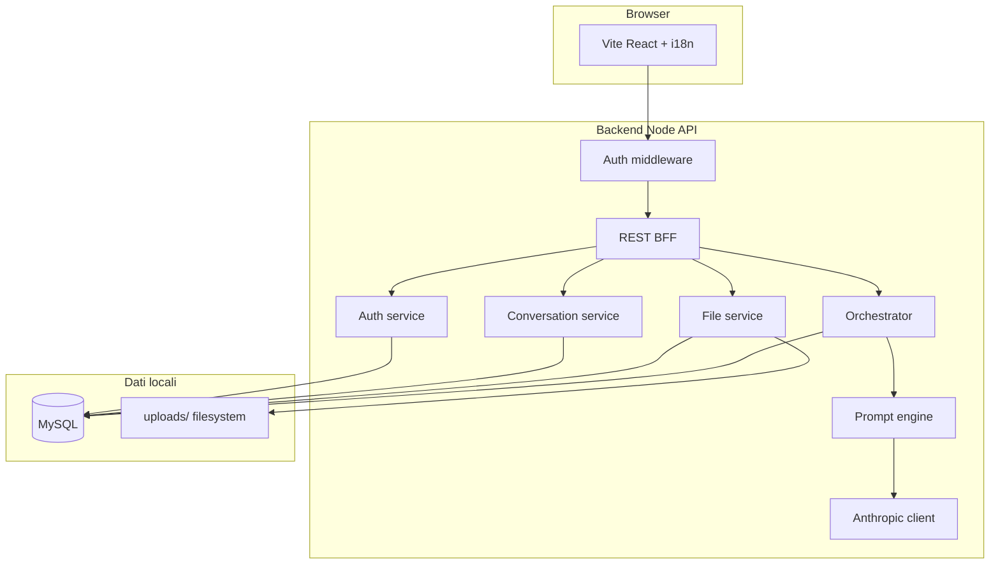

# Architettura tecnica — IntentDraft (beta)

**Documento:** `technical-architecture.md`  
**Versione:** 1.1  
**Stack:** **Accepted** — **Frontend** Vite/React/TS ([template](https://github.com/luismalamoc/react-typescript-template)) · **Backend** Node API + **Prisma** + **MySQL** · **Auth** cookie + tabella `sessions` (ADR-001)  
**LLM:** Anthropic **Claude Sonnet** (OQ-002) — integrazione **fase tardiva**

---

## 1. Stato attuale

Repository greenfield: documentazione in `docs/`; codice applicativo **da avviare** (FOUND-010).

---

## 2. Architettura target — fasi

| Fase               | Contenuto                                                | Stato                |
| ------------------ | -------------------------------------------------------- | -------------------- |
| **1 — Fondamenta** | Auth, MySQL, CRUD conversazioni, upload file, i18n IT/EN | **Priorità attuale** |
| **2 — UI shell**   | Template GitHub (OQ-013) + pagine chat                   | Dopo FOUND           |
| **3 — Motore AI**  | Orchestrator + Anthropic Sonnet + prompt testuale        | Dopo fondamenta      |

---

## 3. Diagramma logico (completo)



**Fase 1:** `ORCH` / `LLM` disabilitati o stub; messaggi user persistiti; risposta assistant placeholder.

---

## 4. Responsabilità componenti

| Componente               | Responsabilità                                                   |
| ------------------------ | ---------------------------------------------------------------- |
| **UI**                   | Login/register, chat, editor prompt, upload, copia, locale IT/EN |
| **Middleware**           | Protezione route; redirect se non autenticato                    |
| **Auth service**         | Register/login/logout, sessioni, hash password (NFR-012)         |
| **Conversation service** | CRUD conversazioni/messaggi per `user_id`                        |
| **File service**         | Upload validato → filesystem + metadati MySQL                    |
| **Orchestrator**         | Stati conversazione AI (fase 3)                                  |
| **Prompt engine**        | IntentModel, generazione **testo prompt**                        |
| **Anthropic client**     | Chiamate Sonnet solo server-side (NFR-001)                       |

Dettaglio operazioni FE↔BE: `frontend-backend-operations.md`.  
Schema DB: `database-design.md`.

---

## 5. Flusso dati — fase fondamenta (pre-LLM)

1. Utente autenticato (cookie sessione).
2. `POST /api/conversations` → riga in MySQL.
3. `POST .../messages` → INSERT messaggio `role=user`.
4. BE risponde con messaggio stub assistant (opzionale) — **nessuna** chiamata Anthropic.
5. Upload → file su disco + `uploaded_files`.

---

## 6. Flusso dati — fase AI (futura)

1. Stesso thread persistito.
2. Orchestrator: `ANALYZE` → `GENERATE` (2 chiamate Sonnet consigliate).
3. INSERT messaggio assistant + `prompt_artifacts.body_markdown`.
4. FE mostra interpretazione + editor prompt; **output = testo** (OQ-008).

---

## 7. Integrazione LLM (Anthropic)

| Aspetto         | Scelta                                        |
| --------------- | --------------------------------------------- |
| Modello         | **Claude Sonnet** (config env)                |
| Quando          | Dopo FOUND-* e contratti BETA-030+            |
| Chiamate        | Solo server-side                              |
| Dev locale      | `LLM_ENABLED=false` fino a chiave configurata |
| Retry / timeout | NFR-002 — come da v1.0 doc                    |

---

## 8. Configurazione locale

```env
DATABASE_URL=mysql://...
SESSION_SECRET=...
UPLOAD_DIR=./uploads
MAX_UPLOAD_BYTES=...
LLM_ENABLED=false
ANTHROPIC_API_KEY=   # solo quando si attiva fase AI
```

---

## 9. Persistenza

| Dato                           | Store                                                      |
| ------------------------------ | ---------------------------------------------------------- |
| Utenti, sessioni, chat, prompt | **MySQL**                                                  |
| File binari                    | **Filesystem** locale                                      |
| Log                            | No contenuto chat in prod (NFR-005) — quando in produzione |

---

## 10. Sicurezza (fase corrente)

- Password hash (bcrypt/argon2).
- Cookie httpOnly, Secure in produzione futura.
- Upload: allowlist MIME, max size, path sanitization, ownership check.
- Prepared statements / ORM per SQL injection.
- Prompt injection: rilevante quando testo file entra nel contesto LLM — fase AI.

---

## 11. Deployment

**Ora:** solo **localhost** — nessun hosting richiesto (founder).

**Futuro:** OQ-012 — da ripianificare (EU/US, GDPR).

---

## 12. Struttura repository proposta

```
intentdraft/
  docs/
  scripts/
  prisma/ or drizzle/     # migrazioni MySQL
  uploads/                # gitignore
  src/
    app/
      [locale]/
      api/
        auth/
        conversations/
        files/
    components/
    lib/
      db/
      auth/
      services/
      llm/                # fase AI
    types/
  tests/
```

---

## 13. ADR

| ADR     | Titolo           |
| ------- | ---------------- |
| ADR-001 | Next.js + MySQL  |
| ADR-002 | Anthropic Sonnet |
| ADR-003 | Sessioni auth    |

---

## 14. Trade-off

| Scelta        | Pro                  | Contro                 |
| ------------- | -------------------- | ---------------------- |
| Next monolith | Veloce per solo dev  | Accoppiamento          |
| MySQL early   | Allinea a OQ-003 C   | Setup locale           |
| LLM dopo      | Focus auth/DB/upload | Valore AI ritardato    |
| File su disco | Semplice localhost   | Backup da gestire dopo |
