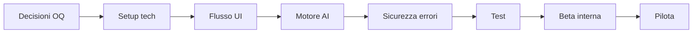

# Roadmap verso la prima beta — PromptPilot

**Documento:** `beta-roadmap.md`  
**Versione:** 1.0  
**Stato repository iniziale:** greenfield (fase 1 completata in documentazione)

Legenda priorità: **P0** critico | **P1** alto | **P2** medio

---

## Percorso critico (sintesi)

**Parallelo possibile:** UX copy (F3) durante F5; dataset valutazione (BETA-085) durante F7.

---

## Fase 1 — Discovery e repository ✅

**Obiettivo:** capire cosa esiste.  
**Stato:** completata (2026-10-25).

- [x] BETA-001 — Ispezionare struttura repo e documenti (`repository-assessment.md`) — **P0**
- [x] BETA-002 — Allineare concept da `initial-brainstorming.md` — **P0**
- [x] BETA-003 — Produrre pacchetto documentazione `docs/product/` — **P0**

**DoD:** documenti 1–8 presenti e incrociati.

---

## Fase 2 — Decisioni prodotto essenziali

**Obiettivo:** sbloccare implementazione.  
**Dipende da:** Fase 1.

- [ ] BETA-010 — Founder: accettare o modificare **OQ-001** stack — **P0** — Deliverable: ADR-001
- [ ] BETA-011 — Founder: **OQ-002** provider/modello + budget — **P0**
- [ ] BETA-012 — Founder: **OQ-003** persistenza sessione — **P1**
- [ ] BETA-013 — Founder: **OQ-005** modello accesso beta (chiusa/rate limit) — **P0**
- [ ] BETA-014 — Confermare **OQ-008** solo generazione prompt — **P1**
- [ ] BETA-015 — Confermare scope **Won't** (auth, file, pagamenti) — **P1**

**DoD:** almeno OQ-001, OQ-002, OQ-005 in stato `Accepted` in `open-questions-and-decisions.md`.

**Blocchi:** implementazione codice senza BETA-010/011.

---

## Fase 3 — Requisiti e UX (documentazione)

**Obiettivo:** baseline congelata per dev.  
**Stato:** documenti creati; opzionale review founder.

- [ ] BETA-020 — Review founder `product-requirements.md` (FR/NFR) — **P1**
- [ ] BETA-021 — Review founder scenari UX — **P1**
- [ ] BETA-022 — Priorizzare 5 casi EV per pilota — **P1**

**DoD:** commenti founder incorporati o ticket espliciti.

---

## Fase 4 — Architettura e contratti

**Dipende da:** BETA-010.

- [ ] BETA-030 — Inizializzare progetto (package.json, TS, lint, format) — **P0** — FR tutti (fondazione)
- [ ] BETA-031 — Definire tipi `IntentModel`, `PromptArtifact` (`ai-prompt-engine-design.md`) — **P0** — FR-002, FR-006
- [ ] BETA-032 — Contratto API `POST /api/conversation` (analyze/generate/regenerate) — **P0** — FR-001–015
- [ ] BETA-033 — `.env.example` + documentazione avvio locale — **P0** — NFR-001
- [ ] BETA-034 — ADR-002 provider e strategia 2-step LLM — **P1**

**Verifica:** chiamata curl mock restituisce JSON valido.

---

## Fase 5 — Setup fondazioni tecniche

**Dipende da:** BETA-030–032.

- [ ] BETA-040 — Modulo `llm/` client server-side con timeout/retry — **P0** — NFR-002
- [ ] BETA-041 — Modulo `validation/` input + output — **P0** — NFR-004
- [ ] BETA-042 — CI minima (lint + unit test su PR) — **P1**
- [ ] BETA-043 — Health endpoint — **P2**

---

## Fase 6 — Flusso principale UI

**Dipende da:** BETA-032, BETA-040.

- [ ] BETA-050 — Layout chat + composer (FR-001, FR-014) — **P0**
- [ ] BETA-051 — Pannello “Cosa ho capito” (FR-002, FR-011) — **P0**
- [ ] BETA-052 — UI domande chiarimento + skip assunzione (FR-003–005) — **P0**
- [ ] BETA-053 — Editor prompt + Copia/Rigenera/Nuova sessione (FR-008–010, FR-013) — **P0**
- [ ] BETA-054 — Stati loading/error UX (FR-015) — **P0**
- [ ] BETA-055 — Messaggi edge case vuoto/limite (FR-001, NFR-004) — **P0**
- [ ] BETA-056 — Responsive base (NFR-007) — **P1**

**DoD:** T-E2E-01, T-E2E-03 verdi con LLM mock.

---

## Fase 7 — Motore AI

**Dipende da:** BETA-031, BETA-040.

- [ ] BETA-060 — Prompt template ANALYZE + parse IntentModel (FR-002–004) — **P0**
- [ ] BETA-061 — Policy turni/domande in orchestrator (FR-004, FR-011) — **P0**
- [ ] BETA-062 — Prompt template GENERATE + PromptArtifact (FR-006–007, FR-020) — **P0**
- [ ] BETA-063 — Refusal fuori scope (FR-012) — **P0**
- [ ] BETA-064 — Rigenerazione (FR-009) — **P1**
- [ ] BETA-065 — Regressione fixture scenari 1–3 — **P1** — T-CONV, T-PROMPT

**DoD:** T-CONV-01..04, T-PROMPT-01..03 verdi.

---

## Fase 8 — Errori, sicurezza, privacy, costi

**Dipende da:** BETA-040, BETA-050.

- [ ] BETA-070 — Rate limiting (NFR-003) — **P0**
- [ ] BETA-071 — Logging senza contenuto conversazione (NFR-005) — **P0**
- [ ] BETA-072 — Pagina “Limiti e privacy” (FR-016, OQ-012) — **P0**
- [ ] BETA-073 — Metriche token/costo per request (NFR-010) — **P1**
- [ ] BETA-074 — Audit manuale no secret in client (NFR-001) — **P0**

**DoD:** T-SEC-02, checklist G4.

---

## Fase 9 — Test e valutazione

**Dipende da:** Fase 6–8.

- [ ] BETA-080 — Suite unit/integration con MSW — **P0**
- [ ] BETA-081 — Suite E2E Playwright — **P0**
- [ ] BETA-082 — Implementare T-ERR, T-SEC — **P0**
- [ ] BETA-083 — Creare `tests/fixtures/eval/` EV-01..15 — **P1**
- [ ] BETA-084 — Sessione rubric con 2 revisori — **P1**
- [ ] BETA-085 — Confronto baseline vs PromptPilot — **P1**
- [ ] BETA-086 — Feedback utile/non utile (FR-017) — **P2**

**DoD:** Gate G1–G3 (`testing-and-evaluation.md`).

---

## Fase 10 — Beta interna

**Dipende da:** BETA-080–082, BETA-072.

- [ ] BETA-090 — Deploy ambiente beta — **P0**
- [ ] BETA-091 — Smoke test produzione — **P0**
- [ ] BETA-092 — Dogfooding team/founder (≥10 sessioni) — **P1**
- [ ] BETA-093 — Triage bug P0/P1 — **P0**

---

## Fase 11 — Beta pilota utenti

**Dipende da:** BETA-090, BETA-084.

- [ ] BETA-100 — Reclutare 5–10 utenti target (P1 persona) — **P1**
- [ ] BETA-101 — Script onboarding + consenso uso dati — **P0**
- [ ] BETA-102 — Raccolta metriche completamento/copia — **P1**
- [ ] BETA-103 — Interviste brevi post-uso — **P1**

---

## Fase 12 — Go/No-Go e retrospettiva

- [ ] BETA-110 — Checklist beta pronta (sezione sotto) — **P0**
- [ ] BETA-111 — Decisione Go/No-Go founder — **P0**
- [ ] BETA-112 — Retro documentata + backlog post-beta — **P1**

---

## Checklist — Beta pronta

- [ ] Tutti FR **Must** implementati (tracciabilità `product-requirements.md` §17)
- [ ] NFR-001, NFR-002, NFR-003, NFR-004, NFR-005, NFR-009 verificati
- [ ] Gate G1–G5 qualità
- [ ] OQ-005 applicato in produzione
- [ ] Informativa limiti/privacy pubblicata
- [ ] Runbook incidenti minimi (rotazione chiave API)
- [ ] Nessun P0 bug aperto

---

## Criteri Go / No-Go

| Go | No-Go |
|----|-------|
| ≥70% casi EV pass rubric | <50% pass |
| Baseline vinta/pareggiata ≥70% | Perdita netta vs baseline |
| Flusso copia completato da ≥80% pilota | Abbandono precoce sistemico |
| Costo/sessione entro budget OQ-002 | Costi fuori controllo |

---

## Problemi che bloccano il rilascio

1. Chiavi API esposte (NFR-001).  
2. Nessun rate limit su endpoint pubblico (OQ-005).  
3. Test E2E Must rossi in CI.  
4. Mancanza informativa trattamento dati verso LLM (FR-016).  
5. Refusal categorie ad alto rischio non funzionante (FR-012).

---

## Miglioramenti post-beta (backlog)

- Libreria prompt locali (OQ-011)
- Export .txt / Markdown download
- Scelta modello UI
- Persistenza opt-in account
- Template verticali marketing/report
- Esecuzione integrata (OQ-008)
- i18n completo

---

## Decisioni founder prima dell’implementazione

1. **OQ-001** Stack  
2. **OQ-002** Provider e budget  
3. **OQ-005** Accesso e costi beta  
4. Conferma scope Won't (auth, file, esecuzione)

---

## Tracciabilità requisiti Must → task

| FR | Task |
|----|------|
| FR-001 | BETA-050, BETA-055 |
| FR-002 | BETA-051, BETA-060 |
| FR-003–005 | BETA-052, BETA-060–061 |
| FR-006–007 | BETA-062 |
| FR-008–010 | BETA-053 |
| FR-009 | BETA-064 |
| FR-011 | BETA-051, BETA-061 |
| FR-012 | BETA-063 |
| FR-013 | BETA-053 |
| FR-014 | BETA-050 |
| FR-015 | BETA-054 |
| FR-016 | BETA-072 |
| NFR-001 | BETA-033, BETA-074 |
| NFR-002 | BETA-040 |
| NFR-003 | BETA-070 |
| NFR-004 | BETA-041, BETA-055 |
| NFR-005 | BETA-071 |
