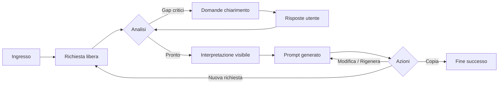

# User journey e UX — PromptPilot (beta)

**Documento:** `user-journeys-and-ux.md`  
**Versione:** 1.0  
**Requisiti correlati:** FR-001 … FR-016, NFR-007–NFR-009  
**UI implementativa:** [`frontend-brand-ui.md`](frontend-brand-ui.md)

---

## 1. Percorso principale (happy path)

1. L’utente apre PromptPilot e legge una breve spiegazione (“Descrivi cosa vuoi ottenere; ti aiutiamo a preparare istruzioni per il tuo AI”).
2. Inserisce testo nel campo principale e invia.
3. Durante l’analisi: indicatore “Sto analizzando la tua richiesta…”.
4. Se servono chiarimenti: messaggio assistant con **1–3 domande max per turno**, linguaggio semplice.
5. Dopo risposte (o se non servono): pannello **“Ecco cosa ho capito”** (obiettivo, destinatario, input, assunzioni).
6. Prompt in area editabile con sezioni leggibili (titoli in italiano, non jargon “system prompt”).
7. Pulsanti: **Copia**, **Rigenera**, **Modifica liberamente**, **Nuova conversazione**.
8. Conferma copia: “Prompt copiato. Incollalo nel tuo strumento AI preferito.”

---

## 2. Stati dell’interfaccia

| Stato UI            | Descrizione                            | Azioni utente                         |
| ------------------- | -------------------------------------- | ------------------------------------- |
| `idle`              | Nessuna richiesta in corso             | Scrivere, inviare                     |
| `analyzing`         | Chiamata LLM analisi                   | Attendere (input disabilitato o coda) |
| `clarifying`        | In attesa risposte utente              | Rispondere nel campo chat             |
| `ready_to_generate` | Interpretazione ok, generazione prompt | Opzionale “Genera prompt” se separato |
| `generating`        | Composizione prompt                    | Attendere                             |
| `prompt_ready`      | Prompt visibile                        | Copia, modifica, rigenera             |
| `error_recoverable` | Timeout / rete                         | Riprova                               |
| `error_fatal`       | Config mancante lato server            | Messaggio + contatto admin (beta)     |
| `unsupported`       | Richiesta fuori scope                  | Suggerimenti cosa fare                |

**Nota implementativa:** analisi + generazione possono essere **una o due** chiamate LLM; l’UX mantiene stati distinti per chiarezza.

---

## 3. Struttura layout (senza mockup grafici)

### 3.1 Desktop

- **Header:** logo/nome PromptPilot, link “Limiti e privacy”, “Nuova conversazione”.
- **Colonna principale (70%):** thread conversazione (bubble user / assistant).
- **Pannello laterale o sezione sotto (30%):** “Cosa ho capito” sticky quando disponibile.
- **Zona prompt (full width sotto thread):** editor monospace o sans leggibile, min-height 200px.

### 3.2 Mobile

- Thread a pieno schermo; pannello interpretazione collassabile (“Dettagli”).
- Prompt in sheet espandibile; Copia sempre visibile (FAB o barra fissa).

---

## 4. Messaggistica (tono non tecnico)

| Situazione    | Esempio copy                                                                                                                           |
| ------------- | -------------------------------------------------------------------------------------------------------------------------------------- |
| Benvenuto     | “Descrivi in poche frasi cosa ti serve. Non serve formulare tutto perfettamente.”                                                      |
| Analisi       | “Sto analizzando la tua richiesta…”                                                                                                    |
| Domanda       | “Per preparare istruzioni più utili: **a chi** è destinato il risultato (es. cliente, capo, team)?”                                    |
| Assunzione    | “Non hai indicato la lunghezza: **assumo** un documento di circa 1 pagina. Puoi correggermi qui sotto.”                                |
| Prompt pronto | “Ecco le istruzioni pronte da usare nel tuo AI. Puoi modificarle prima di copiarle.”                                                   |
| Copia ok      | “Copiato negli appunti.”                                                                                                               |
| Errore rete   | “Non riesco a contattare il servizio. Controlla la connessione e riprova.”                                                             |
| Fuori scope   | “Non posso aiutare con consigli medici o legali. Posso invece aiutarti a preparare istruzioni per attività di lavoro o comunicazione.” |
| Input vuoto   | “Scrivi almeno una frase su cosa vorresti ottenere.”                                                                                   |

---

## 5. Domande di chiarimento — regole UX

- Max **3 domande** per messaggio assistant.
- Preferire scelta guidata quando possibile (“Breve / Medio / Lungo”) oltre al testo libero.
- Mostrare **perché** chiediamo (una riga): “Serve a definire il tono giusto.”
- Pulsante **“Salta — usa un’assunzione ragionevole”** quando il gap non è critico (allinea FR-011).

---

## 6. Edge case

| Caso                                | Comportamento                                                         |
| ----------------------------------- | --------------------------------------------------------------------- |
| Input vuoto                         | Blocco invio + messaggio                                              |
| Solo emoji / spam                   | Richiesta di descrivere il bisogno                                    |
| Testo > limite caratteri            | Contatore + messaggio limite (NFR-004)                                |
| Richiesta in inglese                | Rispondere nella stessa lingua                                        |
| Ambiguità dopo 3 turni chiarimenti  | Procedere con assunzioni esplicite + invito a correggere nel prompt   |
| Utente modifica prompt poi rigenera | Conferma: “La rigenerazione sostituirà le tue modifiche. Continuare?” |
| Timeout                             | Stato `error_recoverable`, conservare testo utente                    |

---

## 7. Accessibilità e responsive

- Focus visibile su input e pulsanti; invio con Enter (Shift+Enter newline).
- `aria-live` su messaggi di stato analisi/errore.
- Contrasto testo ≥ 4.5:1 (target AA).
- Touch target ≥ 44px su mobile.

---

## 8. Scenari completi (3)

### Scenario 1 — Richiesta semplice (no chiarimenti)

**Utente:**  
“Scrivi un’email di ringraziamento al cliente Rossi per l’ordine consegnato ieri, tono cordiale ma professionale, massimo 120 parole.”

**Sistema (interpretazione):**  
Obiettivo: email ringraziamento; destinatario: cliente Rossi; contesto: ordine ieri; tono: cordiale professionale; vincolo: ~120 parole.

**Domande:** nessuna.

**Prompt (estratti):**  
- Ruolo: assistente comunicazione professionale.  
- Compito: redigere email in italiano.  
- Vincoli: tono, lunghezza, niente inventare dettagli ordine oltre “consegna ieri”.  
- Output: solo testo email con oggetto suggerito.

**Azioni utente:** Copia → incolla in LLM esterno.

---

### Scenario 2 — Ambiguità importante

**Utente:**  
“Devo preparare un piano marketing per il prossimo trimestre.”

**Sistema:**  
Interpretazione parziale: obiettivo piano marketing Q+1; mancano: tipo business, budget, canali, obiettivo metrico.

**Domande (turno 1):**  
1. Che tipo di attività o prodotto promuovi?  
2. Qual è l’obiettivo principale (es. più contatti, vendite, notorietà)?  
3. Hai un budget indicativo o va trattato come ipotesi?

**Utente:**  
“Studio dentistico, vorrei più prenotazioni first visit, budget piccolo, mainly social e Google.”

**Sistema:**  
Interpretazione aggiornata + assunzione esplicita: “Budget non quantificato → ipotesi micro-budget PMI”.

**Prompt:**  
Obiettivo prenotazioni; contesto studio dentistico; vincoli budget contenuto; canali social + Google; formato piano con fasi, azioni, metriche suggerite; criteri: realistico per PMI, niente promesse garantite.

---

### Scenario 3 — Complesso con decomposition

**Utente:**  
“Ho un Excel con vendite 12 mesi. Devo capire prodotti top/flop e cosa migliorare, poi preparare una presentazione per il mio direttore commerciale.”

**Sistema:**  
Chiarimento singolo: “Hai solo quantità vendute o anche fatturato/margini?”

**Utente:**  
“Quantità e fatturato, no margini.”

**Prompt (struttura):**  
1. Sezione obiettivo e destinatario.  
2. **Attività numerate:** verifica dati → analisi per prodotto/periodo → insight top/flop → raccomandazioni → outline slide (10–15 slide) → suggerimenti visual.  
3. Vincoli qualità: non inventare dati; segnalare limiti; linguaggio executive.  
4. Formato output LLM: prima analisi strutturata, poi outline presentazione.

**Nota UX:** decomposition visibile come elenco numerato nel prompt, non come “agente che esegue Excel”.

---

## 9. Tracciabilità

| Journey step    | FR             | Test      |
| --------------- | -------------- | --------- |
| Invio richiesta | FR-001         | T-E2E-01  |
| Chiarimenti     | FR-003–005     | T-CONV-02 |
| Interpretazione | FR-002, FR-011 | T-CONV-01 |
| Prompt + copia  | FR-006–010     | T-E2E-03  |
| Errori          | FR-015         | T-ERR-01  |

Vedi [`../quality/testing-and-evaluation.md`](../quality/testing-and-evaluation.md).
