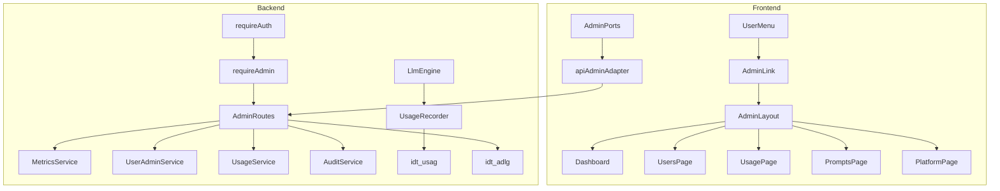

# Piano funzionalità amministratore — IntentDraft

**Documento:** `admin-capabilities-plan.md`  
**Versione:** 2.0 (2026-10-31)  
**Audience:** agente di implementazione (backend + frontend + DB)  
**Stato:** RBAC + console admin implementati (fasi A1–A10, v2.0 runbook)

---

## 0. Come usare questo documento

1. Eseguire le fasi **in ordine** (§9). Non saltare middleware auth admin prima delle route `/api/admin/*`.
2. Ogni fase ha **Definition of Done (DoD)**: test indicati + verifica manuale con account §8.
3. Rispettare **convenzioni repo** esistenti (nomi tabella `idt_*` 8 caratteri, `AppError`, adapter FE, i18n IT/EN).
4. Dopo ogni fase: `backend npm run test`, `frontend npm run build`, aggiornare `database-design.md` se aggiungi tabelle.
5. **Non** implementare impersonation utente, SSO enterprise, RBAC granulari (fuori scope v1).

**Documenti vincolanti da leggere prima di codare:**

| Doc | Percorso |
| --- | -------- |
| Contratto API FE | `docs/product/planning/frontend-implementation-spec.md` §8 |
| Schema DB | `docs/product/architecture/database-design.md` + `backend/prisma/schema.prisma` |
| Operazioni API | `docs/product/architecture/frontend-backend-operations.md` |
| Motore AI / usage | `docs/product/ai/ai-prompt-engine-design.md`, `docs/product/ai/llm-routing-strategy.md` |
| Piano backend | `docs/product/planning/backend-implementation-plan.md` |

**Punti di aggancio nel codice (oggi):**

| Area | Percorso |
| ---- | -------- |
| Auth + `role` DB | `backend/prisma/schema.prisma` (`UserRole`), `userMapper.ts`, seed `devAdminSeed.ts` / `devStandardUserSeed.ts` |
| Sessione | `backend/src/services/sessionService.ts`, `middleware/requireAuth.ts` |
| Registrazione route | `backend/src/app.ts` |
| Tipo utente FE | `frontend/src/types/auth.ts` (`User.role`) |
| Route protette utente | `frontend/src/components/auth/ProtectedRoute.tsx` (solo login, **non** admin) |
| Reset password (riuso admin) | `POST /api/auth/forgot-password`, `passwordResetMailService.ts` |
| LLM + token log | `backend/src/services/llm/anthropicClient.ts` (log `inputTokens`/`outputTokens`) |

---

## 1. Obiettivo prodotto

Definire e implementare la **Admin Console** per utenti con `role = admin`:

- visibilità operativa (utenti, chat, salute, costi LLM);
- gestione utenti e ruoli;
- configurazione piattaforma (limiti, prompt di sistema, feature flag);
- compliance leggera (testi legali, traccia consensi cookie).

Utenti `role = user` continuano a vedere **solo** i propri dati (`user_id` da sessione).

---

## 2. Modello ruoli (RBAC minimale)

| Ruolo | DB | Creazione | Ambito API |
| ----- | -- | --------- | ---------- |
| **user** | `UserRole.user` | `POST /api/auth/register`, seed `DEV_STANDARD_USER_*` | `/api/*` tranne `/api/admin/*` |
| **admin** | `UserRole.admin` | seed `DEV_ADMIN_*`, `PATCH` admin su altro utente | `/api/*` + `/api/admin/*` |

**Regola sicurezza:** un admin **non** può rimuovere il proprio ruolo admin se è l’**ultimo** admin nel sistema (`LAST_ADMIN`).

**Fuori scope v1:** editor/billing-only, impersonation, audit certificato WORM.

---

## 3. Stato attuale vs gap

| Voce | Stato | Note |
| ---- | ----- | ---- |
| Colonna `User.role` | ✅ | Prisma + DTO backend; tipo FE |
| `role` in risposta login/me | ✅ | Verificare che FE non ignori il campo negli adapter |
| Middleware `requireAdmin` | ❌ | Da creare |
| Modulo `backend/src/modules/admin/` | ❌ | Da creare |
| Route `/app/admin/*` | ❌ | Da creare |
| `AdminRoute` / guard FE | ❌ | Da creare |
| Tabella usage LLM | ❌ | Da creare |
| Tabella audit admin | ❌ | Da creare |
| `User.status` (disabilitato) | ❌ | Opzionale fase A5 |

---

## 4. Architettura target



---

## 5. Schema database (nuove entità)

Seguire §2.1 `database-design.md`: nomi fisici **8 caratteri** `idt_xxxx`.

### 5.1 `idt_usag` — eventi uso LLM (modello Prisma suggerito: `LlmUsageEvent`)

| Colonna | Tipo | Note |
| ------- | ---- | ---- |
| `id` | UUID PK | |
| `user_id` | UUID FK → `idt_user` | |
| `conversation_id` | UUID FK nullable | |
| `phase` | VARCHAR(32) | `ANALYZE` \| `GENERATE` \| altro |
| `provider` | VARCHAR(32) | `anthropic` (v1) |
| `model` | VARCHAR(127) | es. da `ANTHROPIC_MODEL` |
| `input_tokens` | INT | |
| `output_tokens` | INT | |
| `usd_estimate` | DECIMAL(10,6) nullable | da tariffa env |
| `latency_ms` | INT nullable | |
| `created_at` | TIMESTAMPTZ | |

**Indici:** `(user_id, created_at DESC)`, `(created_at)`.

**Inserimento:** un record per ogni chiamata riuscita in `createAnthropicClient().complete` (o wrapper unico in `llmEngine.ts`), **non** in mock engine (opzionale flag `recordMock=false`).

**Costo stimato:** env `LLM_USD_PER_1M_INPUT`, `LLM_USD_PER_1M_OUTPUT` (default 0 = solo token, no USD).

### 5.2 `idt_adlg` — audit azioni admin (modello: `AdminAuditLog`)

| Colonna | Tipo | Note |
| ------- | ---- | ---- |
| `id` | UUID PK | |
| `admin_user_id` | UUID FK | chi agisce |
| `action` | VARCHAR(64) | es. `USER_ROLE_CHANGE`, `USER_DISABLE` |
| `target_type` | VARCHAR(32) | `user`, `config`, `prompt_template` |
| `target_id` | VARCHAR(255) nullable | UUID o chiave |
| `metadata` | JSONB nullable | diff, motivo |
| `created_at` | TIMESTAMPTZ | |

### 5.3 `idt_ptpl` — template prompt piattaforma (modello: `PlatformPromptTemplate`)

| Colonna | Tipo | Note |
| ------- | ---- | ---- |
| `id` | UUID PK | |
| `key` | VARCHAR(64) UNIQUE | es. `analyze_system`, `generate_system` |
| `provider` | VARCHAR(32) | `anthropic` \| `*` default |
| `body` | TEXT | markdown o testo system prompt |
| `version` | INT | incrementale |
| `active` | BOOLEAN | solo una attiva per `(key, provider)` |
| `updated_by` | UUID FK nullable | admin |
| `created_at`, `updated_at` | TIMESTAMPTZ | |

**Runtime:** orchestrator legge template attivi; se assenti, fallback a stringhe hardcoded attuali in `llm/` (comportamento invariato).

### 5.4 `idt_conf` — configurazione piattaforma (modello: `PlatformConfig`)

KV JSON per limiti editabili senza redeploy:

| Colonna | Tipo | Note |
| ------- | ---- | ---- |
| `key` | VARCHAR(64) PK | es. `rate_limit.messages.max` |
| `value` | JSONB | numero o oggetto |
| `updated_by` | UUID nullable | |
| `updated_at` | TIMESTAMPTZ | |

**v1 alternativa (più semplice):** solo lettura env in admin UI + documentazione “modifica `.env`”; implementare `idt_conf` se serve override runtime.

### 5.5 Estensione `idt_user` — account disabilitato (fase A5)

| Colonna | Tipo | Note |
| ------- | ---- | ---- |
| `status` | ENUM `active`,`disabled` | default `active` |

**Login:** se `disabled` → `403` `ACCOUNT_DISABLED`. **Sessioni esistenti:** invalidare on disable (delete `idt_sess` per `user_id`).

### 5.6 `idt_cook` — log consenso cookie (fase A10, opzionale)

| Colonna | Tipo | Note |
| ------- | ---- | ---- |
| `id` | UUID | |
| `user_id` | UUID nullable | null se guest |
| `choice` | ENUM `accepted`,`rejected` | |
| `created_at` | TIMESTAMPTZ | |

FE oggi salva solo `localStorage` (`CookieConsentBanner.tsx`); fase A10 aggiunge `POST /api/consent/cookie` (auth opzionale) + sync admin.

**Migrazione:** `npx prisma migrate dev --name admin_schema` dopo aggiornamento `schema.prisma`; aggiornare §4 di `database-design.md`.

---

## 6. Backend — implementazione dettagliata

### 6.1 Middleware `requireAdmin`

**File:** `backend/src/middleware/requireAdmin.ts`

```typescript
// Dopo requireAuth (o composto):
// if (request.user?.role !== 'admin') throw AppError(403, 'FORBIDDEN', ...)
```

**Pattern:** come `createRequireAuth`, registrare su scope Fastify admin:

```typescript
// app.ts
await app.register(async (adminScope) => {
  adminScope.addHook('preHandler', requireAuth);
  adminScope.addHook('preHandler', requireAdmin);
  await adminScope.register(adminRoutes, { env });
}, { prefix: '/api/admin' });
```

**Rate limit:** scope dedicato `admin` (es. 120 req / 15 min) in `plugins/rateLimitScopes.ts`.

### 6.2 Modulo admin — struttura cartelle

```
backend/src/modules/admin/
  routes.ts           # registra sotto-routes
  metricsRoutes.ts
  usersRoutes.ts
  usageRoutes.ts
  promptsRoutes.ts
  platformRoutes.ts
  schemas.ts          # zod
  dto.ts              # tipi risposta
  services/
    metricsService.ts
    userAdminService.ts
    usageService.ts
    auditService.ts   # writeAdminAudit(...)
```

**Audit:** ogni mutazione (role, disable, template PUT) chiama `auditService.log({ adminId, action, targetType, targetId, metadata })`.

### 6.3 Contratti API (v1 — implementare esattamente)

Prefisso: **`/api/admin`**. Errori: `{ error: { code, message, details? } }` come resto API.

#### GET `/api/admin/metrics/overview`

Query opzionale: `?days=7`

**Response 200:**

```json
{
  "users": {
    "total": 42,
    "newLast7Days": 5,
    "newLast30Days": 12,
    "byAuthProvider": { "local": 30, "google": 12 }
  },
  "conversations": {
    "total": 120,
    "active": 98,
    "messagesLast7Days": 340,
    "promptReadyRate": 0.62
  },
  "system": {
    "healthOk": true,
    "dbOk": true
  },
  "llm": {
    "callsLast7Days": 80,
    "inputTokensLast7Days": 120000,
    "outputTokensLast7Days": 45000,
    "estimatedUsdLast7Days": 1.23
  }
}
```

**Implementazione metriche:**

- Utenti: `prisma.user.count`, `count` con `createdAt >= now()-7d`.
- Conversazioni: `idt_conv`; `promptReadyRate` = conv con almeno un `idt_prmt` / conv con messaggi user.
- LLM: aggregare `idt_usag` (se vuota, zeri).
- Health: riusare `pingDatabase()` da `lib/db.ts` + flag `ok` interno.

#### GET `/api/admin/users`

Query: `page=1`, `pageSize=20`, `q=` (email/displayName ILIKE).

**Response:**

```json
{
  "items": [
    {
      "id": "uuid",
      "email": "user@example.com",
      "displayName": "User",
      "authProvider": "local",
      "role": "user",
      "locale": "it",
      "status": "active",
      "createdAt": "ISO",
      "lastSessionAt": "ISO|null"
    }
  ],
  "page": 1,
  "pageSize": 20,
  "total": 100
}
```

`lastSessionAt`: `MAX(idt_sess.created_at)` o `expires_at` — documentare scelta in codice.

#### GET `/api/admin/users/:id`

Dettaglio + conteggi: conversazioni, messaggi, file, usage LLM 30gg.

#### PATCH `/api/admin/users/:id`

Body (partial):

```json
{ "role": "admin" | "user", "status": "active" | "disabled" }
```

Regole:

- Non downgrade ultimo admin → `409` `LAST_ADMIN`.
- Non auto-disabilitare se stesso senza conferma esplicita (opzionale: bloccare `status: disabled` su self).
- On disable: `prisma.session.deleteMany({ userId })`.

#### POST `/api/admin/users/:id/force-password-reset`

Body vuoto. Solo utenti `passwordHash != null`. Chiama stessa logica di `forgot-password` (token + email). Audit log.

#### GET `/api/admin/users/:id/usage`

Query: `from`, `to` ISO date.

**Response:** serie giornaliera + totali token/costo per fase/modello.

#### GET `/api/admin/usage/export`

Query: `from`, `to`, `format=csv`.

**Response:** `text/csv` attachment, colonne: `date,user_email,phase,model,input_tokens,output_tokens,usd_estimate`.

#### GET `/api/admin/prompt-templates`

Lista template attivi + versioni recenti per chiave.

#### PUT `/api/admin/prompt-templates/:key`

Body: `{ "provider": "anthropic", "body": "...", "activate": true }`

Crea nuova versione; se `activate`, disattiva precedente stessa key+provider.

#### POST `/api/admin/prompt-templates/dry-run`

Body: `{ "userText": "...", "locale": "it" }`

**Response:** `{ "intentModel": {...}, "promptMarkdown": "..." }` senza persistere conv/messaggi. Riusa orchestrator in modalità `dryRun: true` (refactor minimo pipeline).

#### GET `/api/admin/platform/settings`

Legge env safe + override `idt_conf` se presente (max message chars, upload bytes, rate limits read-only da env in v1 semplice).

#### PUT `/api/admin/platform/settings`

Solo chiavi allowlist in v1: es. feature flags boolean in `idt_conf`.

#### GET `/api/admin/compliance/legal`

Restituisce testi markdown per pagine legali (da `idt_conf` keys `legal.limits_it`, etc.) o file statici repo.

#### PUT `/api/admin/compliance/legal`

Body: `{ "page": "limits", "locale": "it", "markdown": "..." }`

---

## 7. Frontend — implementazione dettagliata

### 7.1 Guard e routing

**File nuovi:**

- `frontend/src/components/auth/AdminRoute.tsx` — wrapper: `user?.role === 'admin'` else `<Navigate to="/app" />`.
- `frontend/src/pages/admin/AdminLayout.tsx` — tab nav: Dashboard, Utenti, Uso API, Prompt, Piattaforma.
- Pagine: `AdminDashboardPage.tsx`, `AdminUsersPage.tsx`, `AdminUserDetailPage.tsx`, `AdminUsagePage.tsx`, `AdminPromptsPage.tsx`, `AdminPlatformPage.tsx`.

**`AppRoutes.tsx`:**

```tsx
<Route path="/app/admin" element={<ProtectedRoute><AdminRoute><AdminLayout /></AdminRoute></ProtectedRoute>}>
  <Route index element={<AdminDashboardPage />} />
  <Route path="users" element={<AdminUsersPage />} />
  ...
</Route>
```

**Layout scroll:** usare stesso pattern di `/app/settings` (non `isChatShell` in `MainLayout.tsx`).

### 7.2 Port adapter

**File:** `frontend/src/adapters/api/apiAdminAdapter.ts`  
**Registro:** `frontend/src/adapters/index.ts`, `PortsProvider` — aggiungere `ports.admin`.

**Tipo:** `AdminPort` in `adapters/types.ts` con metodi mirror API §6.3.

**Mock:** `mockAdminAdapter.ts` — dati fittizi per `VITE_USE_MOCK=true` (dashboard con numeri demo, lista utenti da authStore).

### 7.3 UX menu

**`UserMenu.tsx`:** voce link `to="/app/admin"` visibile solo se `user.role === 'admin'`, label i18n `nav.admin`.

### 7.4 Componenti UI

Riutilizzare: `AppPanelFrame`, `GlassPanel`, `AppDialog`, `ConfirmModal`, tabelle semplici Tailwind.

**AdminUsersPage:** tabella paginata, search debounced 300ms, azioni con `ConfirmModal` (promuovi/revoca, disabilita, reset password).

**AdminUsagePage:** filtro date + pulsante export (window.open o download blob CSV).

**AdminPromptsPage:** editor textarea monospace + anteprima dry-run split pane.

### 7.5 i18n

Aggiungere namespace `admin.*` in `frontend/src/i18n/locales/it.ts` e `en.ts` (titoli tab, colonne tabella, messaggi conferma).

### 7.6 Errori

Mappare `FORBIDDEN`, `LAST_ADMIN`, `ACCOUNT_DISABLED` in `errors.*` i18n.

---

## 8. Account di test (development)

| Account | Email | Password (default `.env`) | Ruolo |
| ------- | ----- | ------------------------- | ----- |
| Admin | `admin@intentdraft.local` | `DEV_ADMIN_PASSWORD` | admin |
| Standard | `user@intentdraft.local` | `DEV_STANDARD_USER_PASSWORD` | user |

**Verifica RBAC manuale:**

1. Login admin → menu mostra “Amministrazione”, `/app/admin` accessibile.
2. Login standard → `/app/admin` redirect a `/app`.
3. Chiamata diretta `GET /api/admin/metrics/overview` con cookie user → `403 FORBIDDEN`.

---

## 9. Fasi di implementazione (ordine obbligatorio)

Ogni fase: PR/commit separato consigliato; test verdi prima di fase successiva.

### Fase A1 — Admin gate (backend + FE shell)

| Step | Azione |
| ---- | ------ |
| A1.1 | Creare `requireAdmin.ts` |
| A1.2 | Modulo `admin/routes.ts` con `GET /api/admin/health` → `{ ok: true, admin: true }` |
| A1.3 | Registrare scope in `app.ts` |
| A1.4 | FE: `AdminRoute`, layout vuoto, link menu admin |
| A1.5 | Test integrazione: admin 200, user 403 su `/api/admin/health` |

**DoD A1:** admin vede pagina “Admin” placeholder; user no.

---

### Fase A2 — Audit log

| Step | Azione |
| ---- | ------ |
| A2.1 | Prisma `AdminAuditLog` → `idt_adlg` |
| A2.2 | `auditService.log` |
| A2.3 | Hook su ogni mutazione admin futura |

**DoD A2:** migrazione applicata; test unit su `log` insert.

---

### Fase A3 — Usage tracking LLM

| Step | Azione |
| ---- | ------ |
| A3.1 | Prisma `LlmUsageEvent` → `idt_usag` |
| A3.2 | `usageRecorder.record(event)` chiamato da `anthropicClient` o `llmEngine` con `userId`, `conversationId`, `phase` |
| A3.3 | Env tariffa opzionale USD |
| A3.4 | Test unit: record + aggregate sum |

**DoD A3:** dopo messaggio in API mode con LLM on, riga in `idt_usag`.

---

### Fase A4 — Dashboard metrics

| Step | Azione |
| ---- | ------ |
| A4.1 | `metricsService.buildOverview(days)` |
| A4.2 | `GET /api/admin/metrics/overview` |
| A4.3 | FE `AdminDashboardPage` card KPI |
| A4.4 | Test integrazione snapshot numeri |

**DoD A4:** dashboard popolata con dati reali DB.

---

### Fase A5 — Gestione utenti

| Step | Azione |
| ---- | ------ |
| A5.1 | Colonna `User.status` + migrazione |
| A5.2 | Blocco login in `auth/routes.ts` se disabled |
| A5.3 | `GET/PATCH /api/admin/users`, `GET :id` |
| A5.4 | `POST .../force-password-reset` |
| A5.5 | FE lista + dettaglio + modali conferma |
| A5.6 | Test: LAST_ADMIN, disable, reset email path |

**DoD A5:** admin promuove user a admin; non può eliminare ultimo admin.

---

### Fase A6 — Usage per utente + export CSV

| Step | Azione |
| ---- | ------ |
| A6.1 | `usageService.byUser`, `exportCsv` |
| A6.2 | Routes usage + export |
| A6.3 | FE pagina Uso API + download |
| A6.4 | Test integrazione CSV header |

---

### Fase A7 — Piattaforma e limiti

| Step | Azione |
| ---- | ------ |
| A7.1 | Scegliere: solo read env in UI **oppure** `idt_conf` |
| A7.2 | `GET/PUT /api/admin/platform/settings` (allowlist) |
| A7.3 | FE form feature flag + testi read-only limiti env |
| A7.4 | (Opzionale) applicare override rate limit a runtime — complesso; documentare se rinviato |

---

### Fase A8 — Prompt templates piattaforma

| Step | Azione |
| ---- | ------ |
| A8.1 | Prisma `PlatformPromptTemplate` |
| A8.2 | CRUD admin routes |
| A8.3 | Caricamento template in `llmEngine` / prompt builder |
| A8.4 | FE editor versioni |
| A8.5 | Test: cambio template → output LLM diverso (mock LLM in test) |

---

### Fase A9 — Dry-run admin

| Step | Azione |
| ---- | ------ |
| A9.1 | Refactor orchestrator: param `dryRun` senza write DB |
| A9.2 | `POST /api/admin/prompt-templates/dry-run` |
| A9.3 | FE pannello anteprima JSON + markdown |

---

### Fase A10 — Compliance (legal + cookie)

| Step | Azione |
| ---- | ------ |
| A10.1 | Storage markdown legal (`idt_conf` o `docs` sync) |
| A10.2 | Admin editor + FE `LimitsPage` legge da API se presente |
| A10.3 | `idt_cook` + endpoint consenso; estendere `CookieConsentBanner` POST silenzioso |
| A10.4 | Admin vista tabella consensi aggregati |

---

## 10. Funzionalità per area (riferimento §3 originale)

| Area §3 | Fase | Note implementative |
| ------- | ---- | ------------------- |
| 3.1 Dashboard | A4 | KPI §6.3 |
| 3.2 Costi API | A3, A6 | `idt_usag` + export |
| 3.3 Utenti | A5 | paginazione, LAST_ADMIN |
| 3.4 Prompt sistema | A8, A9 | `idt_ptpl` + dry-run |
| 3.5 Limiti/sicurezza | A7 | file rejected: query `idt_file.scan_status=rejected` in admin |
| 3.6 Legal/cookie | A10 | collegare banner mock esistente |

---

## 11. Test obbligatori

| ID | Tipo | Descrizione |
| -- | ---- | ----------- |
| T-ADMIN-01 | integration | Non-admin → 403 su `/api/admin/*` |
| T-ADMIN-02 | integration | Admin → overview 200 |
| T-ADMIN-03 | integration | PATCH role + LAST_ADMIN |
| T-ADMIN-04 | integration | Disable user → login fail |
| T-ADMIN-05 | unit | usageRecorder cost calculation |
| T-ADMIN-06 | e2e Playwright | Admin login → dashboard; user blocked from `/app/admin` |

Aggiungere file `backend/tests/integration/admin.test.ts` e `frontend/e2e/admin.spec.ts` nelle fasi corrispondenti.

---

## 12. Sicurezza e privacy

- Admin routes **sempre** dietro `requireAuth` + `requireAdmin`.
- Non esporre `passwordHash`, token reset, `SESSION_SECRET` in API admin.
- Export CSV: solo admin; rate limit export (max N/giorno opzionale).
- Log audit **senza** contenuto messaggi chat (solo id conversazione).
- Allineamento NFR-005: niente PII nei log applicativi oltre email in audit protetto.

---

## 13. Checklist pre-merge (agent)

- [ ] `backend npm run test` pass
- [ ] `frontend npm run build` pass
- [ ] `prisma migrate` / `db push` documentato in `backend/README.md` se nuove tabelle
- [ ] `database-design.md` aggiornato con nuove tabelle §5
- [ ] i18n IT + EN per stringhe user-facing admin
- [ ] Verifica manuale con account §8
- [ ] Nessun segreto in commit

---

## 14. Riferimenti

- [`docs/product/requirements/product-requirements.md`](../requirements/product-requirements.md)
- [`docs/product/ai/llm-routing-strategy.md`](../ai/llm-routing-strategy.md)
- [`docs/product/architecture/database-design.md`](../architecture/database-design.md)
- [`docs/product/planning/backend-implementation-plan.md`](backend-implementation-plan.md)
- [`docs/product/planning/frontend-implementation-spec.md`](frontend-implementation-spec.md)

---

## 15. Cronologia documento

| Versione | Data | Modifica |
| -------- | ---- | -------- |
| 1.0 | 2026-10-31 | Piano iniziale perimetro admin |
| 2.0 | 2026-10-31 | Guida implementazione agent: schema, API, FE, fasi A1–A10, test, DoD |
