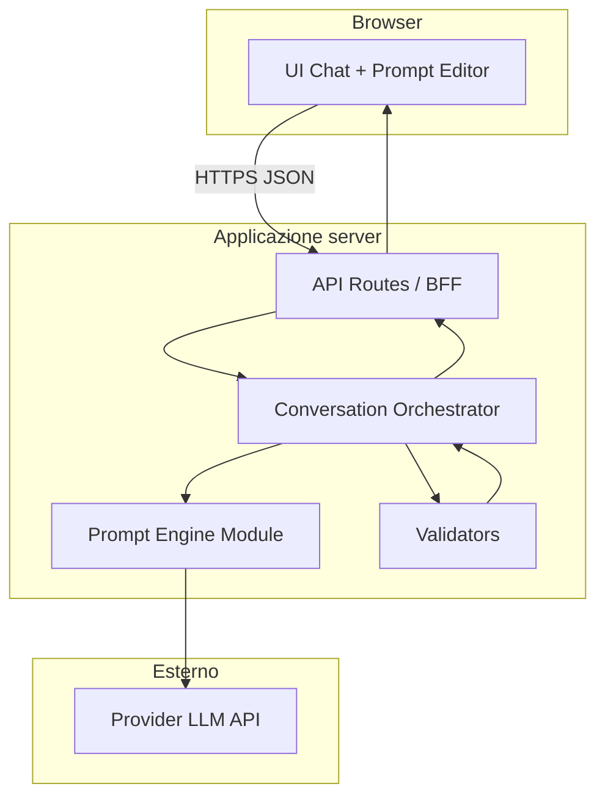

# Architettura tecnica — PromptPilot (beta)

**Documento:** `technical-architecture.md`  
**Versione:** 1.0  
**Stato attuale:** vedi `repository-assessment.md` (greenfield)  
**Stack:** **Raccomandazione** pending OQ-001 — descrizione sotto assume **Next.js + TypeScript** come opzione proposta, non approvata.

---

## 1. Stato attuale

Nessun componente runtime. Documentazione concept in `docs/`.

---

## 2. Architettura target beta (logica)



### 2.1 Responsabilità

| Componente        | Responsabilità                                                                                   |
| ----------------- | ------------------------------------------------------------------------------------------------ |
| **UI**            | Thread chat, interpretazione, editor prompt, copia, stati loading/error                          |
| **API (BFF)**     | Auth beta opzionale, rate limit, proxy LLM, nessuna chiave al client                             |
| **Orchestrator**  | Macchina a stati conversazione, merge risposte chiarimenti, decide analyze vs generate           |
| **Prompt Engine** | Prompt di sistema, parsing structured output, policy domande (vedi `ai-prompt-engine-design.md`) |
| **Validators**    | Lunghezza input, schema JSON risposta modello, guardrail output                                  |

---

## 3. Flusso dati (sessione tipica)

1. Client invia `{ sessionId?, messages[], phase }`.
2. API applica rate limit + validazione input.
3. Orchestrator determina azione: `ANALYZE` | `CLARIFY_RESPONSE` | `GENERATE` | `REGENERATE`.
4. Engine costruisce messaggi per LLM (system + developer + user).
5. Risposta LLM → parse JSON (IntentModel) o testo prompt finale.
6. API restituisce `{ uiState, interpretation?, assistantMessage?, prompt?, assumptions[] }`.
7. **Persistenza beta default:** stato conversazione nel **client** (React state); opzionale `sessionId` server in-memory con TTL breve se serve rate limit — decisione OQ-003.

**Dati da non conservare (default raccomandato):** log con contenuto messaggi utente; storico DB.

---

## 4. Integrazione LLM

| Aspetto  | Scelta beta                                                                                               |
| -------- | --------------------------------------------------------------------------------------------------------- |
| Chiamate | Solo server-side                                                                                          |
| Modello  | Config env `LLM_MODEL`, `LLM_API_KEY`                                                                     |
| Pattern  | Chat Completions o Responses API con **JSON mode / schema** per fase analisi                              |
| Fasi     | Preferibile **2 chiamate**: (1) analisi + piano domande (2) generazione prompt — riduce prompt monolitici |
| Retry    | Backoff su 429/503, max 2 retry                                                                           |
| Timeout  | 30–60s configurabile                                                                                      |

**Alternative considerate:** singola chiamata end-to-end (meno latency, peggio controllo); orchestrazione multi-agent (fuori scope).

---

## 5. Configurazione e segreti

- `.env.local` (dev), variabili su host (prod): `LLM_API_KEY`, `LLM_PROVIDER`, `LLM_MODEL`, `RATE_LIMIT_*`, `MAX_INPUT_CHARS`.
- Mai committare segreti; `.env.example` senza valori.
- Errori API → messaggio generico client (“servizio temporaneamente non disponibile”).

---

## 6. Errori, timeout, validazione

| Tipo                            | Gestione                                                  |
| ------------------------------- | --------------------------------------------------------- |
| Input troppo lungo              | 400 + messaggio UX                                        |
| JSON invalido da modello        | Retry una volta con “fix JSON”; fallback messaggio errore |
| Provider down                   | 503 + retry client                                        |
| Rate limit                      | 429 + “riprova tra poco”                                  |
| Contenuto fuori policy provider | Messaggio neutro, no leak dettagli                        |

Output prompt: controllo deterministico minimo (presenza sezione obiettivo se segnalato nell’intent; lunghezza max prompt).

---

## 7. Persistenza

| Dato               | Beta raccomandata                                                             |
| ------------------ | ----------------------------------------------------------------------------- |
| Conversazione      | Client-only                                                                   |
| Session rate limit | Redis o in-memory (single instance) — **Could** usare Redis se multi-instance |
| Feedback utile/non | Log aggregato anonimo o file — **Should** opzionale                           |
| Account            | Nessuno                                                                       |

---

## 8. Logging e osservabilità

- Log strutturati (request id, latency, token usage, esito).
- **No** body messaggi utente in prod (NFR-005).
- Metriche: conteggio richieste, errori, token/sessione (export dashboard provider/hosting).

---

## 9. Sicurezza e privacy

- HTTPS obbligatorio in produzione.
- Rate limiting per IP (e sessionId se presente).
- Headers sicurezza (CSP base, no sniffing).
- **Prompt injection:** istruzioni system che trattano input utente come dati; separazione ruoli; per beta **no upload file** (OQ-009).
- Avvertenza UI: contenuti inviati a provider terzo (OQ-012).
- Ambiti ad alto impatto: classifier leggero in analisi → rifiuto template (FR-012).

---

## 10. Costi e limiti

- Budget alert lato provider.
- Cap giornaliero richieste (env) per beta.
- Stima: 2 chiamate LLM × token input/output — monitorare in `testing-and-evaluation.md`.

---

## 11. Deployment e ambienti

| Ambiente  | Scopo                  |
| --------- | ---------------------- |
| `local`   | Dev con chiave founder |
| `preview` | PR preview (opzionale) |
| `beta`    | Pilota ristretto       |

**Hosting raccomandato (con Next.js):** Vercel o equivalente Node edge/serverless — **Decisione aperta** legata OQ-001.

---

## 12. Struttura repository proposta (post decisione stack)

```
PromptPilot/
  docs/
  src/                    # o app/ se Next App Router
    app/                  # pages + api routes
    components/
    lib/
      orchestrator/
      prompt-engine/
      llm/
      validation/
    types/
  tests/
    unit/
    integration/
    e2e/
  .env.example
  package.json
```

Adattare quando OQ-001 è Accepted.

---

## 13. ADR da redigere

- **ADR-001** Stack
- **ADR-002** Provider LLM e strategia 1 vs 2 chiamate
- **ADR-003** Persistenza sessione e logging

---

## 14. Tracciabilità componenti → requisiti

| Componente    | NFR / FR                       |
| ------------- | ------------------------------ |
| API + env     | NFR-001                        |
| Orchestrator  | FR-003–005, FR-013             |
| Prompt Engine | FR-006–007, FR-011, FR-020     |
| UI            | FR-001, FR-008–010, FR-014–016 |
| Validators    | FR-012, NFR-004                |

---

## 15. Trade-off riassuntivi

| Scelta         | Pro               | Contro               |
| -------------- | ----------------- | -------------------- |
| Next monolith  | Veloce, un deploy | Accoppiamento        |
| Stato client   | Privacy, semplice | No sync multi-device |
| 2 chiamate LLM | Controllo qualità | Costo/latency        |
| No DB          | Meno ops          | No analytics ricche  |
